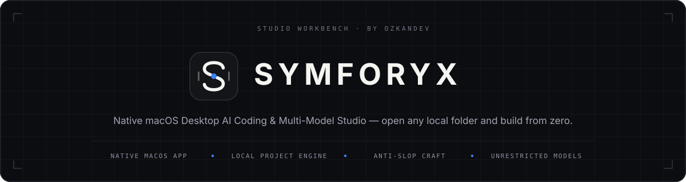
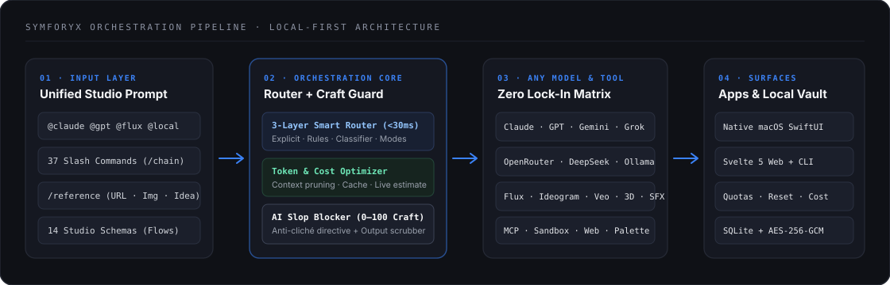

<div align="center">

<picture>
  <source media="(prefers-color-scheme: dark)" srcset="./assets/brand/symforyx-banner-dark.svg" />
  <source media="(prefers-color-scheme: light)" srcset="./assets/brand/symforyx-banner-light.svg" />
  
</picture>

<br />
<br />

**English** &nbsp;·&nbsp; **[Türkçe](./README.tr.md)**

<br />


-1D4ED8?style=flat-square&labelColor=1F232D)


<br />

> **You are the conductor. Models and tools are the orchestra.**
> Generate visuals with any image engine, code with any LLM, attach URL/image/idea references, audit output with an integrated **AI Slop Blocker**, and monitor live token budgets, quotas, and per-prompt costs — all locally.

</div>

---

## Core Capabilities

<table>
  <tr>
    <td width="50%" valign="top">
      <h3>Zero Lock-In Model & Tool Matrix</h3>
      <p>Use <strong>Anthropic Claude</strong>, <strong>OpenAI GPT</strong>, <strong>Google Gemini</strong>, <strong>DeepSeek</strong>, <strong>xAI Grok</strong>, <strong>OpenRouter</strong>, local <strong>Ollama</strong>, <strong>Flux / Fal</strong>, <strong>Stability</strong>, <strong>Ideogram</strong>, <strong>ComfyUI</strong>, Video/3D/Music studios, and any custom OpenAI-compatible endpoint or custom model ID.</p>
    </td>
    <td width="50%" valign="top">
      <h3>AI Slop Blocker & Craft Score (0–100)</h3>
      <p>Two-layer craft enforcement (<code>ANTI-SLOP ON</code> / <code>/anti-slop</code>): pre-generation system & image directives ban cliché prose, sycophancy, and neon-gradient UI slop, while the post-generation scrubber cleans filler and stamps every reply with a live <code>CRAFT</code> score.</p>
    </td>
  </tr>
  <tr>
    <td width="50%" valign="top">
      <h3>Token & Cost Optimizer + Live Telemetry</h3>
      <p>Real-time navbar readout of <strong>Outgoing</strong> & <strong>Remaining</strong> context tokens, per-prompt cost estimates before sending, per-turn cost receipts, and an automatic context compressor that prunes redundant history while protecting pinned turns.</p>
    </td>
    <td width="50%" valign="top">
      <h3>Per-Provider Quotas & Reset Countdowns</h3>
      <p>Track exactly how much you used, what remains, when each quota resets (hourly, 5-hour, daily, weekly, monthly countdowns), and cumulative cost across every model provider and tool.</p>
    </td>
  </tr>
  <tr>
    <td width="50%" valign="top">
      <h3>Universal <code>/reference</code> & Reference Tray</h3>
      <p>Feed websites, URLs, reference images (with explicit roles: <em>Style, Layout, Palette, Subject, Edit Source</em>), existing artifacts, or written creative constraints directly into any generation via the tray or <code>/ref &lt;url|idea&gt;</code>.</p>
    </td>
    <td width="50%" valign="top">
      <h3>14 Ready Studio Production Schemas</h3>
      <p>One-click multi-step pipelines for <strong>App Store / Play Store 5-Screen Kits</strong>, <strong>TR+EN ASO</strong>, <strong>Video / Promo Storyboards</strong>, <strong>Code + Visual + 3D + Music</strong>, SaaS Launch, Brand Identity, and more — with per-step model overrides and approval gates.</p>
    </td>
  </tr>
  <tr>
    <td width="50%" valign="top">
      <h3>100% Native macOS SwiftUI App + Web</h3>
      <p>Run as a <strong>~2 MB native Apple Silicon SwiftUI app</strong> (zero WebView, zero Electron overhead) with built-in backend lifecycle management, or via the editorial Svelte 5 Web UI and CLI — all with 1-click <strong>Light / Dark / System</strong> themes and <strong>TR / EN</strong> localization.</p>
    </td>
    <td width="50%" valign="top">
      <h3>Local-First Vault & Full Workspace Control</h3>
      <p>API keys stay encrypted locally with <strong>AES-256-GCM</strong>. Chats, versioned artifacts, FTS5 full-text search, and project memories live in local <strong>SQLite (WAL)</strong>. Create or delete any workspace (including the default General Workspace) freely.</p>
    </td>
  </tr>
</table>

---

## Architecture

<div align="center">
  
</div>

---

## 6 Orchestration Modes

| Mode | Command / Trigger | How It Works |
| :--- | :--- | :--- |
| **Smart** | Default (`<30ms` router) | 3-layer router inspects `@mentions`, file types, rules, and intent to pick the best model automatically. |
| **Manual** | `@claude`, `@gpt`, `@flux`, Model Picker | Pin or override any provider and custom model ID with zero restrictions. |
| **Chain** | `/chain a > b > c` | Sequential pipeline where each model receives the previous step's output and artifacts directly. |
| **Compare** | `/compare @claude @gpt @gemini ...` | Parallel side-by-side execution in columns; pick the winning branch with one click. |
| **Council** | `/council ...` | Multi-model deliberation: Producer drafts → Critics review → Arbiter synthesizes the final craft output. |
| **Agent** | `/agent ...` | Plan → Execute sandboxed tools (Web Search, Code Sandbox, Palette, MCP) → Synthesize with artifacts. |

---

## Slash Commands (`37` Built-In, EN + TR Aliases)

Type `/` in the composer to open the categorized autocomplete menu. All English commands and Turkish aliases work interchangeably:

| Category | Commands |
| :--- | :--- |
| **Media & Design** | `/image`, `/edit`, `/video`, `/music`, `/3d`, `/palette`, `/store-kit`, `/aso` |
| **Code & Preview** | `/code`, `/run`, `/preview`, `/review`, `/debug`, `/refactor`, `/test`, `/sql`, `/docs` |
| **Orchestration** | `/chain`, `/compare`, `/council`, `/agent`, `/handoff`, `/flow`, `/save-schema` |
| **References & Web** | `/reference` (`/ref`, `/referans`), `/search`, `/read`, `/summarize`, `/translate` |
| **Craft & Control** | `/anti-slop` (`/slop`), `/optimize`, `/cost`, `/quotas`, `/pin`, `/memory`, `/export`, `/clear` |

---

## Quick Start

### Requirements
- [Bun](https://bun.sh) `1.2+`
- *(Optional, for Native macOS `.app`)* macOS 14+ with Xcode Command Line Tools (`swiftc`)

### 1. Run Locally (Auto Port Discovery)

```bash
git clone https://github.com/ozkandev/SYMFORYX.git
cd SYMFORYX
bun install

# Starts API server + SvelteKit UI together (auto-picks free ports if 3000 is busy)
bun run dev
```

### 2. Production Build

```bash
bun run build
bun run start
```

### 3. Build & Launch Native macOS App (Zero WebView)

```bash
bash apps/macos-native/build-app.sh
open apps/macos-native/SYMFORYX.app
```

> `SYMFORYX.app` compiles directly with `swiftc` + SwiftUI + AppKit, generates a native vector Retina `AppIcon.icns`, and automatically attaches to a running SYMFORYX backend or boots its own local engine on port `3456`.

### 4. CLI & Docker

```bash
# CLI Examples
bun run cli -- chat "@gorsel editorial coffee roastery landing page" --out design.svg
bun run cli -- flow list
bun run cli -- flow run magaza-gorselleri --input appName="SYMFORYX"
bun run cli -- keys set anthropic sk-ant-...
bun run cli -- usage --month

# Docker
cp .env.example .env
docker compose up -d
```

---

## Brand Identity

The SYMFORYX mark combines **two opposing harmonic arcs** (forming a precision geometric **S** for *Symphony*) converging into a **single cobalt conductor nexus node**, flanked by minimal orchestration cadence rails.

<div align="center">
  <table>
    <tr>
      <td align="center" width="220">
        
        <br /><sub><code>symforyx-mark.svg</code> · Obsidian</sub>
      </td>
      <td align="center" width="220">
        
        <br /><sub><code>symforyx-mark-light.svg</code> · Alabaster</sub>
      </td>
    </tr>
  </table>
</div>

---

## Project Structure

```text
SYMFORYX/
├── apps/
│   ├── server/           # Bun + Hono Gateway, Orchestrator, SSE streaming, REST API
│   ├── web/              # SvelteKit (Svelte 5) + Tailwind CSS v4 editorial web client
│   ├── macos-native/     # 100% Native SwiftUI + AppKit macOS .app (zero WebView)
│   ├── cli/              # symforyx terminal CLI
│   └── desktop/          # Optional Tauri 2 shell configuration
├── packages/
│   ├── core/             # SymMessage schema, types, 37 slash commands, TR/EN parser
│   ├── db/               # SQLite (WAL + FTS5) store, quotas, AES-256-GCM Key Vault
│   ├── providers/        # Anthropic, OpenAI, Gemini, DeepSeek, Grok, OpenRouter, Ollama, Flux, Video/3D/Audio
│   ├── router/           # 3-Layer Smart Router (<30ms)
│   ├── context/          # Shared context, Token Optimizer, AI Slop Blocker (Craft Audit)
│   ├── flows/            # Flow Engine + 14 Studio Production Schemas
│   ├── agent/            # Plan-Execute-Synthesize Agent Runner
│   ├── tools-sdk/        # @symforyx/tools-sdk
│   ├── tools-runtime/    # Permission engine, sandbox runner, MCP discovery client
│   ├── tools/            # Built-in tools (Web Search, Code Sandbox, Live Preview, WCAG Palette)
│   └── i18n/             # Turkish (tr.json) & English (en.json) dictionaries
├── assets/brand/         # Minimal SVG logo marks, dark/light README banners & architecture diagram
├── flows-templates/      # YAML studio flow definitions
└── registry/             # Tool Store catalog
```

---

## Verification & Tests

```bash
# Run full end-to-end test suite (Parser, AES Vault, Router, Context, Optimizer, Slop Blocker, Flows, Workspaces)
cd apps/server && bun test tests/symforyx.test.ts

# Type-check & build Web UI
cd apps/web && ./node_modules/.bin/svelte-check --tsconfig ./tsconfig.json && ./node_modules/.bin/vite build
```

---

<div align="center">


**SYMFORYX** · *You are the conductor. Models and tools are the orchestra.*
Designed & built by **ozkandev** · MIT License · © 2026

</div>
