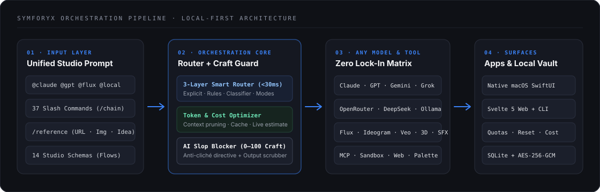

<div align="center">

<picture>
  <source media="(prefers-color-scheme: dark)" srcset="./assets/brand/symforyx-banner-dark.svg" />
  <source media="(prefers-color-scheme: light)" srcset="./assets/brand/symforyx-banner-light.svg" />
  
</picture>

<br />
<br />

**[English](./README.md)** &nbsp;·&nbsp; **Türkçe**

<br />


-1D4ED8?style=flat-square&labelColor=1F232D)


<br />

> **Sen şefsin. Modeller ve araçlar orkestra.**
> Görseli istediğin motorla, kodu istediğin modelle üret; URL, görsel ve fikir referansları ekle; yerleşik **AI Slop Blocker** ile çıktıları mükemmelleştir; canlı token, kota, sıfırlanma süresi ve prompt maliyetini tamamen yerel olarak yönet.

</div>

---

## Öne Çıkan Özellikler

<table>
  <tr>
    <td width="50%" valign="top">
      <h3>Kısıtlamasız Model & Araç Matrisi</h3>
      <p><strong>Anthropic Claude</strong>, <strong>OpenAI GPT</strong>, <strong>Google Gemini</strong>, <strong>DeepSeek</strong>, <strong>xAI Grok</strong>, <strong>OpenRouter</strong>, yerel <strong>Ollama</strong>, <strong>Flux / Fal</strong>, <strong>Stability</strong>, <strong>Ideogram</strong>, <strong>ComfyUI</strong>, Video/3D/Müzik stüdyoları ve dilediğin özel OpenAI uyumlu uç nokta veya model ID’si ile özgürce üret.</p>
    </td>
    <td width="50%" valign="top">
      <h3>AI Slop Blocker & Zanaat Skoru (0–100)</h3>
      <p>Çift katmanlı kalite kalkanı (<code>ANTI-SLOP ON</code> / <code>/anti-slop</code>): üretim öncesi direktifler klişe metinleri, yağcı açılışları ve neon-gradyan AI-slop arayüz kalıplarını engeller; üretim sonrası temizleyici dolgu ifadeleri ayıklayıp her mesaja canlı <code>CRAFT</code> skoru işler.</p>
    </td>
  </tr>
  <tr>
    <td width="50%" valign="top">
      <h3>Token & Maliyet Optimizasyonu</h3>
      <p>Üst çubukta canlı <strong>Giden</strong> ve <strong>Kalan</strong> bağlam token göstergesi, gönderim öncesi tahmini prompt maliyeti, her prompt turunun gerçek maliyet fişi ve sabitlenmiş mesajları koruyarak eski bağlamı sıkıştıran otomatik optimize edici.</p>
    </td>
    <td width="50%" valign="top">
      <h3>Canlı Araç Kotaları & Sıfırlanma Sayaçları</h3>
      <p>Her sağlayıcı ve araçta ne kadar kullanım yaptığını, ne kadar kaldığını, ne zaman sıfırlanacağını (saatlik, 5 saatlik, günlük, haftalık, aylık geri sayım) ve toplam maliyeti tek ekranda gör.</p>
    </td>
  </tr>
  <tr>
    <td width="50%" valign="top">
      <h3>Evrensel <code>/referans</code> & Referans Tepsisi</h3>
      <p>Web sitelerini, URL’leri, referans görselleri (<em>Stil, Düzen, Renk, Konu, Düzenleme Kaynağı</em> rolleriyle), mevcut artefaktları veya yazılı tasarım kısıtlarını <code>/referans &lt;url|fikir&gt;</code> ya da tepsi üzerinden doğrudan üretime bağla.</p>
    </td>
    <td width="50%" valign="top">
      <h3>14 Hazır Stüdyo Üretim Şeması</h3>
      <p><strong>App Store / Play Store 5’li Mağaza Görselleri</strong>, <strong>TR+EN ASO Paketi</strong>, <strong>Video / Promo Prodüksiyonu</strong>, <strong>Kod + Görsel + 3D + Müzik</strong>, SaaS Lansman ve Marka Kimliği gibi adım bazlı model seçilebilir hazır akışlar.</p>
    </td>
  </tr>
  <tr>
    <td width="50%" valign="top">
      <h3>%100 Native macOS SwiftUI Uygulaması + Web</h3>
      <p>WebView veya Electron olmadan <strong>~2 MB native Apple Silicon SwiftUI uygulaması</strong> olarak kullan; ya da editoryal Svelte 5 Web arayüzü ve CLI’dan eriş. Tek tıkla <strong>Açık / Koyu / Sistem</strong> tema ve <strong>TR / EN</strong> dil değişimi.</p>
    </td>
    <td width="50%" valign="top">
      <h3>Yerel Öncelikli Kasa & Tam Çalışma Alanı Kontrolü</h3>
      <p>API anahtarları <strong>AES-256-GCM</strong> ile yerel olarak şifrelenir. Sohbetler, sürümlü artefaktlar, FTS5 tam metin araması ve proje hafızası yerel <strong>SQLite (WAL)</strong> veritabanında saklanır. Genel Çalışma Alanı dahil tüm çalışma alanları serbestçe oluşturulabilir ve silinebilir.</p>
    </td>
  </tr>
</table>

---

## Mimari Genel Bakış

<div align="center">
  
</div>

---

## 6 Orkestrasyon Modu

| Mod | Komut / Tetikleyici | Nasıl Çalışır? |
| :--- | :--- | :--- |
| **Akıllı (Smart)** | Varsayılan (`<30 ms` yönlendirici) | 3 katmanlı yönlendirici `@etiket`, dosya türü, kurallar ve niyeti analiz ederek en uygun modeli otomatik seçer. |
| **Manuel** | `@claude`, `@gpt`, `@flux`, Model Seçici | Kısıtlama olmadan dilediğin sağlayıcıyı ve özel model ID’sini sabitleyip doğrudan çalıştır. |
| **Zincir (Chain)** | `/zincir a > b > c` | Ardışık hat: her adım bir önceki modelin metnini ve artefaktlarını doğrudan devralır. |
| **Karşılaştır** | `/karsilastir @claude @gpt @gemini ...` | Modelleri yan yana sütunlarda paralel çalıştırır; kazanan yanıtı tek tıkla ana dal seçersin. |
| **Konsey (Council)** | `/konsey ...` | Üretici taslak çıkarır → Eleştirmen modeller inceler → Hakem model en rafine çıktıyı sentezler. |
| **Ajan (Agent)** | `/ajan ...` | Planla → Sandbox araçlarını (Web Araması, Kod Sandbox, Renk Paleti, MCP) kullan → Artefaktla sentezle. |

---

## Slash Komutları (`37` Yerleşik Komut, EN + TR Takma Adlar)

Yazı alanına `/` yazdığında kategorili otomatik tamamlama menüsü açılır. İngilizce komutlar ve Türkçe kısayollar birebir çalışır:

| Kategori | Komutlar |
| :--- | :--- |
| **Medya & Tasarım** | `/image` (`/gorsel`), `/edit` (`/duzenle`), `/video`, `/music`, `/3d`, `/palette` (`/palet`), `/store-kit`, `/aso` |
| **Kod & Önizleme** | `/code` (`/kod`), `/run` (`/calistir`), `/preview` (`/onizle`), `/review`, `/debug`, `/refactor`, `/test`, `/sql`, `/docs` |
| **Orkestrasyon** | `/chain` (`/zincir`), `/compare` (`/karsilastir`), `/council` (`/konsey`), `/agent` (`/ajan`), `/handoff`, `/flow`, `/save-schema` |
| **Referans & Web** | `/reference` (`/ref`, `/referans`), `/search` (`/ara`), `/read` (`/oku`), `/summarize` (`/ozetle`), `/translate` |
| **Kalite & Kontrol** | `/anti-slop` (`/slop`), `/optimize`, `/cost`, `/quotas`, `/pin`, `/memory`, `/export`, `/clear` |

---

## Hızlı Başlangıç

### Gereksinimler
- [Bun](https://bun.sh) `1.2+`
- *(İsteğe bağlı, Native macOS `.app` için)* macOS 14+ ve Xcode Command Line Tools (`swiftc`)

### 1. Yerelde Çalıştırma (Otomatik Port Seçimi)

```bash
git clone https://github.com/ozkandev/SYMFORYX.git
cd SYMFORYX
bun install

# API sunucusu + SvelteKit arayüzünü birlikte başlatır (3000 doluysa boş port seçer)
bun run dev
```

### 2. Üretim Derlemesi

```bash
bun run build
bun run start
```

### 3. Native macOS Uygulamasını Derle ve Aç (WebView Yok)

```bash
bash apps/macos-native/build-app.sh
open apps/macos-native/SYMFORYX.app
```

> `SYMFORYX.app` doğrudan `swiftc` + SwiftUI + AppKit ile derlenir, vektörel Retina `AppIcon.icns` ikonunu üretir ve çalışan bir SYMFORYX sunucusuna otomatik bağlanır (veya `3456` portunda kendi yerel motorunu başlatır).

### 4. CLI & Docker

```bash
# CLI Örnekleri
bun run cli -- chat "@gorsel minimalist kahve dükkanı ana sayfası" --out tasarim.svg
bun run cli -- flow list
bun run cli -- flow run magaza-gorselleri --input appName="SYMFORYX"
bun run cli -- keys set anthropic sk-ant-...
bun run cli -- usage --month

# Docker
cp .env.example .env
docker compose up -d
```

---

## Marka Kimliği

SYMFORYX logosu, *Senfoni*’yi simgeleyen **karşılıklı iki harmonik yay** (geometrik **S** formu) ile bunların tam merkezinde birleştiği **kobalt şef düğümünü** ve iki yandaki minimal orkestrasyon kadans çizgilerini birleştirir.

<div align="center">
  <table>
    <tr>
      <td align="center" width="220">
        
        <br /><sub><code>symforyx-mark.svg</code> · Obsidyen</sub>
      </td>
      <td align="center" width="220">
        
        <br /><sub><code>symforyx-mark-light.svg</code> · Alabaster</sub>
      </td>
    </tr>
  </table>
</div>

---

## Proje Yapısı

```text
SYMFORYX/
├── apps/
│   ├── server/           # Bun + Hono Gateway, Orkestratör, SSE akışı, REST API
│   ├── web/              # SvelteKit (Svelte 5) + Tailwind CSS v4 editoryal web istemcisi
│   ├── macos-native/     # %100 Native SwiftUI + AppKit macOS .app (sıfır WebView)
│   ├── cli/              # symforyx terminal aracı
│   └── desktop/          # İsteğe bağlı Tauri 2 kabuk yapılandırması
├── packages/
│   ├── core/             # SymMessage şeması, tipler, 37 slash komutu, TR/EN ayrıştırıcı
│   ├── db/               # SQLite (WAL + FTS5) depo, kotalar, AES-256-GCM Anahtar Kasası
│   ├── providers/        # Anthropic, OpenAI, Gemini, DeepSeek, Grok, OpenRouter, Ollama, Flux, Video/3D/Ses
│   ├── router/           # 3 Katmanlı Akıllı Yönlendirici (<30 ms)
│   ├── context/          # Ortak bağlam, Token Optimize Edici, AI Slop Blocker (Craft Denetimi)
│   ├── flows/            # Akış Motoru + 14 Hazır Stüdyo Şeması
│   ├── agent/            # Planla-Uygula-Sentezle Ajan Çalıştırıcı
│   ├── tools-sdk/        # @symforyx/tools-sdk
│   ├── tools-runtime/    # İzin motoru, sandbox yürütücü, MCP istemcisi
│   ├── tools/            # Yerleşik araçlar (Web Araması, Kod Sandbox, Canlı Önizleme, WCAG Palet)
│   └── i18n/             # Türkçe (tr.json) ve İngilizce (en.json) sözlükleri
├── assets/brand/         # Minimal SVG logo seti, koyu/açık README banner'ları ve mimari şema
├── flows-templates/      # YAML stüdyo akış şablonları
└── registry/             # Araç Mağazası kataloğu
```

---

## Test ve Doğrulama

```bash
# Uçtan uca test paketini çalıştır (Parser, AES Kasa, Router, Bağlam, Optimizer, Slop Blocker, Akışlar, Çalışma Alanları)
cd apps/server && bun test tests/symforyx.test.ts

# Web arayüzü tip kontrolü ve derleme
cd apps/web && ./node_modules/.bin/svelte-check --tsconfig ./tsconfig.json && ./node_modules/.bin/vite build
```

---

<div align="center">


**SYMFORYX** · *Sen şefsin. Modeller ve araçlar orkestra.*
Tasarlayan ve geliştiren: **ozkandev** · MIT Lisansı · © 2026

</div>
