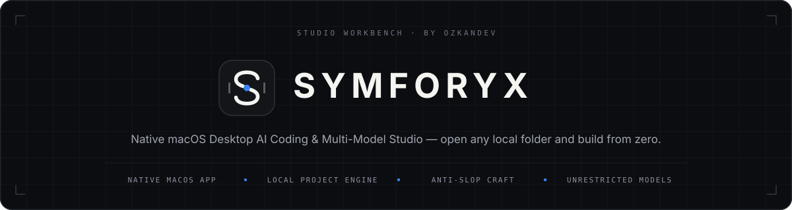

<div align="center">

<picture>
  <source media="(prefers-color-scheme: dark)" srcset="./assets/brand/symforyx-banner-dark.svg" />
  <source media="(prefers-color-scheme: light)" srcset="./assets/brand/symforyx-banner-light.svg" />
  
</picture>

<br />
<br />

**[English](./README.md)** &nbsp;·&nbsp; **Türkçe**

<br />

-1D4ED8?style=flat-square&labelColor=1F232D)


<br />

> **macOS için %100 native masaüstü AI kodlama ve üretim stüdyosu — Claude Code Desktop deneyimi, tek bir sağlayıcıya kilitlenmeden.**
> Bilgisayarından mevcut bir proje klasörü aç ya da sıfırdan yeni proje oluştur; gerçek dosyaları düzenle, canlı Git diff’lerini incele, yerleşik terminalde komut çalıştır, istediğin modelle kod/görsel/3D/müzik üret, **AI Slop Blocker** ile kaliteyi koru ve canlı token/kota/maliyet takibi yap — hepsi ~2 MB native SwiftUI uygulamasının içinde.

</div>

---

## Neden SYMFORYX Masaüstü?

<table>
  <tr>
    <td width="50%" valign="top">
      <h3>%100 Native macOS Uygulaması (WebView Yok)</h3>
      <p>Apple Silicon (macOS 14+) için saf <strong>SwiftUI + AppKit</strong> ile derlenir. Electron yok, tarayıcı sekmesi yok, ağır bellek tüketimi yok. Arka planda yerel Bun orkestrasyon motorunu otomatik yönetir ve tek komutla <code>/Applications/SYMFORYX.app</code> içine kurulur.</p>
    </td>
    <td width="50%" valign="top">
      <h3>Claude Code Tarzı Yerel Proje Motoru</h3>
      <p><strong>Klasör Aç…</strong> ile Mac’indeki herhangi bir projeyi bağla ya da <strong>Sıfırdan…</strong> ile yeni proje başlat (<em>Boş, TypeScript/Bun, Web, Python, Swift</em>). Canlı dosya ağacında gez, native kod editöründe düzenle (<code>⌘S</code>), renkli <strong>Git Diff</strong> gör ve yerleşik <strong>Proje Terminali</strong> ile gerçek <code>zsh</code> komutları çalıştır.</p>
    </td>
  </tr>
  <tr>
    <td width="50%" valign="top">
      <h3>Otomatik Diske Yazma & Tek Tık Uygulama</h3>
      <p>Modeller bağlı klasörünün dosya ağacını ve Git dalını otomatik görür. <strong>AUTO-APPLY ON</strong> açıkken üretilen dosya blokları doğrudan diske yazılır; kapalıyken her mesajdaki <strong>Diske Uygula</strong> düğmesi veya <code>/apply</code> komutuyla onaylı şekilde uygularsın.</p>
    </td>
    <td width="50%" valign="top">
      <h3>Kısıtlamasız Model & Medya Matrisi</h3>
      <p>Kodu <strong>Claude</strong>, <strong>GPT</strong>, <strong>Gemini</strong>, <strong>DeepSeek</strong>, <strong>Grok</strong>, <strong>OpenRouter</strong> veya yerel <strong>Ollama</strong> ile yaz; görseli <strong>Flux / Fal</strong>, <strong>Stability</strong>, <strong>Ideogram</strong>, <strong>ComfyUI</strong>, Video/3D/Müzik motorlarıyla üret — dilediğin özel model ID’sini serbestçe ekle.</p>
    </td>
  </tr>
  <tr>
    <td width="50%" valign="top">
      <h3>AI Slop Blocker & Canlı Craft Skoru (0–100)</h3>
      <p>Çift katmanlı kalite kalkanı (<code>ANTI-SLOP ON</code> / <code>/anti-slop</code>): üretim öncesi yönergeler klişe dili, yağcı girişleri ve mor-neon AI-slop arayüz kalıplarını engeller; üretim sonrası temizleyici dolgu ifadeleri ayıklayıp her yanıta canlı <code>CRAFT</code> skoru işler.</p>
    </td>
    <td width="50%" valign="top">
      <h3>Token Optimizasyonu, Kotalar & Prompt Maliyeti</h3>
      <p>Üst çubukta canlı <strong>Giden</strong> ve <strong>Kalan</strong> token göstergesi, gönderim öncesi maliyet tahmini, her prompt turunun gerçek maliyeti, otomatik bağlam sıkıştırma ve her araç/sağlayıcı için <strong>Kalan Kota + Sıfırlanma Geri Sayımı</strong>.</p>
    </td>
  </tr>
  <tr>
    <td width="50%" valign="top">
      <h3>Evrensel <code>/referans</code> & Referans Tepsisi</h3>
      <p>Mac’inden referans görsel (<em>Stil, Düzen, Renk, Konu, Düzenleme Kaynağı</em> rolleriyle), web sitesi/URL veya yazılı fikir/kısıtları doğrudan tepsiden ya da <code>/referans &lt;url|fikir&gt;</code> ile üretime bağla.</p>
    </td>
    <td width="50%" valign="top">
      <h3>14 Hazır Stüdyo Üretim Şeması</h3>
      <p><strong>App Store / Play Store 5’li Mağaza Görselleri</strong>, <strong>TR+EN ASO Paketi</strong>, <strong>Video / Promo</strong>, <strong>Kod + Görsel + 3D + Müzik</strong>, SaaS Lansman, Marka Kimliği gibi adım bazlı model seçilebilir hazır akışlar.</p>
    </td>
  </tr>
</table>

---

## macOS Masaüstünde Başlatma

### Gereksinimler
- **macOS 14+** (Apple Silicon) ve Xcode Command Line Tools (`swiftc`)
- [Bun](https://bun.sh) `1.2+`

### 1. `SYMFORYX.app` Derle ve Aç

```bash
git clone https://github.com/ozkandev/SYMFORYX.git
cd SYMFORYX
bun install

# Native SwiftUI uygulamasını + Retina AppIcon.icns ikonunu derler ve doğrudan açar
bun run app
```

### 2. `/Applications` Klasörüne Kur (Spotlight & Dock’tan Aç)

```bash
bun run app:install
```

> `SYMFORYX.app` arka planda `127.0.0.1:3456` yerel motorunu otomatik başlatır — kurduktan sonra `/Applications` içinden çift tıklayarak veya `⌘Space → SYMFORYX` yazarak doğrudan kullanabilirsin.

### 3. Bilgisayardan Proje Açma veya Sıfırdan Başlatma
1. Sol menüdeki **Klasör Aç** (veya başlangıç ekranındaki **Bilgisayardan Proje Klasörü Aç**) düğmesiyle Mac’indeki herhangi bir proje klasörünü seç.
2. Veya **Sıfırdan** düğmesiyle yeni bir proje klasörü oluştur (`Boş`, `TypeScript/Bun`, `Web`, `Python`, `Swift`).
3. Sol **PROJE DOSYALARI** ağacından dosyalara tıklayıp sağdaki native **Kod Editörü**’nde düzenle (`⌘S`), **Git Diff** sekmesinden değişiklikleri gör, alttaki **Terminal** çekmecesinde `bun test` / `npm run build` / `swift build` çalıştır, **AUTO-APPLY ON** ile AI değişikliklerini doğrudan projene uygula.

---

## Mimari Genel Bakış

<div align="center">
  
</div>

---

## 6 Orkestrasyon Modu & Yerel Proje Komutları

| Mod | Tetikleyici | Çalışma Şekli |
| :--- | :--- | :--- |
| **Akıllı (Smart)** | Varsayılan (`<30 ms` yönlendirici) | `@etiket`, dosya türü ve niyete göre en uygun modeli otomatik seçer. |
| **Serbest / Manuel** | `@claude`, `@gpt`, `@flux`, Model Seçici | Kısıtlama olmadan dilediğin sağlayıcıyı ve özel model ID’sini kullan. |
| **Zincir (Chain)** | `/zincir a > b > c` | Her model bir önceki adımın kodunu ve artefaktlarını doğrudan devralır. |
| **Karşılaştır** | `/karsilastir @claude @gpt @gemini ...` | Modelleri paralel çalıştırır; en iyi çıktıyı tek tıkla ana dal seçersin. |
| **Konsey (Council)** | `/konsey ...` | Üretici → Eleştirmenler → Hakem çoklu model sentezi. |
| **Ajan (Agent)** | `/ajan ...` | Planla → Araçları ve yerel komutları çalıştır → Sentezle. |

### Yerleşik Slash Komutları (`43` Komut, EN + TR Kısayollar)

| Kategori | Komutlar |
| :--- | :--- |
| **Yerel Proje IDE** | `/tree` (`/agac`), `/cat` (`/dosya`), `/grep`, `/sh` (`/terminal`), `/diff`, `/apply` (`/uygula`) |
| **Kod & Önizleme** | `/code` (`/kod`), `/run` (`/calistir`), `/preview` (`/onizle`), `/review`, `/debug`, `/refactor`, `/test`, `/sql`, `/docs` |
| **Medya & Stüdyo** | `/image` (`/gorsel`), `/edit` (`/duzenle`), `/video`, `/music`, `/3d`, `/palette` (`/palet`), `/store`, `/aso`, `/launch`, `/ads`, `/brand` |
| **Orkestrasyon** | `/chain` (`/zincir`), `/compare` (`/karsilastir`), `/council` (`/konsey`), `/agent` (`/ajan`), `/flow` (`/akis`), `/handoff`, `/save-schema` |
| **Referans & Kontrol** | `/reference` (`/ref`, `/referans`), `/anti-slop` (`/slop`), `/optimize`, `/cost` (`/maliyet`), `/quota` (`/kota`), `/memory` (`/hafiza`), `/search`, `/read`, `/export` |

---

## Marka Kimliği

SYMFORYX logosu, *Senfoni*’yi simgeleyen **karşılıklı iki harmonik yay** (geometrik **S**) ile bunların merkezinde birleştiği **kobalt şef düğümünü** ve minimal orkestrasyon kadans çizgilerini birleştirir.

<div align="center">
  <table>
    <tr>
      <td align="center" width="220">
        
        <br /><sub><code>symforyx-mark.svg</code> · Obsidyen</sub>
      </td>
      <td align="center" width="220">
        
        <br /><sub><code>symforyx-mark-light.svg</code> · Alabaster</sub>
      </td>
    </tr>
  </table>
</div>

---

## Proje Yapısı

```text
SYMFORYX/
├── apps/
│   ├── macos-native/     # ANA UYGULAMA: %100 Native SwiftUI + AppKit macOS .app (WebView yok)
│   │   ├── Sources/      # AppMain, Models, SymforyxStore, Views, LocalWorkspaceViews
│   │   ├── gen-icon.swift# Retina Apple .icns vektörel ikon üreticisi
│   │   └── build-app.sh  # Doğrudan swiftc derleyici -> SYMFORYX.app
│   ├── server/           # Yerel Bun + Hono motoru, Yerel Proje FS/Terminal/Git Motoru, Orkestratör
│   ├── cli/              # Terminal CLI (`bun run cli -- ...`)
│   └── web/              # İsteğe bağlı Svelte 5 yardımcı arayüz (`bun run dev:all`)
├── packages/
│   ├── core/             # SymMessage şeması, tipler, 43 slash komutu, TR/EN ayrıştırıcı
│   ├── db/               # SQLite (WAL + FTS5) yerel depo, kotalar, AES-256-GCM Anahtar Kasası
│   ├── providers/        # Anthropic, OpenAI, Gemini, DeepSeek, Grok, OpenRouter, Ollama, Flux, Video/3D/Ses
│   ├── router/           # 3 Katmanlı Akıllı Yönlendirici (<30 ms)
│   ├── context/          # Ortak bağlam, Token Optimize Edici, AI Slop Blocker (Craft Skoru)
│   ├── flows/            # Akış Motoru + 14 Hazır Stüdyo Şeması
│   ├── agent/            # Ajan Çalıştırıcı
│   ├── tools-sdk/        # @symforyx/tools-sdk
│   ├── tools-runtime/    # İzin motoru, sandbox yürütücü, MCP istemcisi
│   ├── tools/            # Yerleşik araçlar (Web Araması, Kod Sandbox, Canlı Önizleme, WCAG Palet)
│   └── i18n/             # Türkçe & İngilizce sözlükler
├── assets/brand/         # Minimal SVG logo seti, koyu/açık banner'lar ve mimari şema
└── flows-templates/      # YAML stüdyo akış şablonları
```

---

## Test ve Doğrulama

```bash
# Uçtan uca test paketini çalıştır (18 test: Yerel Proje Motoru, Çalışma Alanları, AI Slop Blocker, Optimizer, Akışlar, Kasa)
cd apps/server && bun test tests/symforyx.test.ts

# Native macOS uygulamasını yeniden derle
bun run app:build

# İsteğe bağlı CLI kullanımı
bun run cli -- chat "@claude temiz bir TypeScript worker pool tasarla"
bun run cli -- flow run magaza-gorselleri --input appName="SYMFORYX"
bun run cli -- usage --month
```

---

<div align="center">


**SYMFORYX** · *Native macOS AI Kodlama ve Orkestrasyon Stüdyosu.*
Tasarlayan ve geliştiren: **ozkandev** · MIT Lisansı · © 2026

</div>
