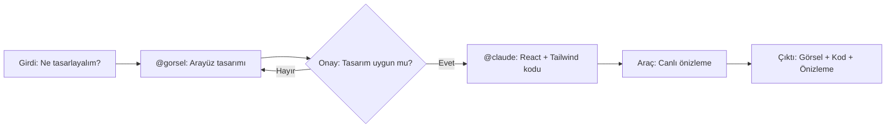
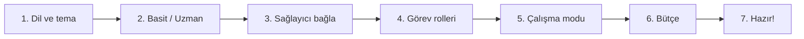
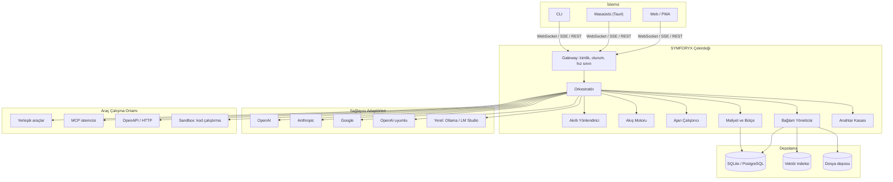
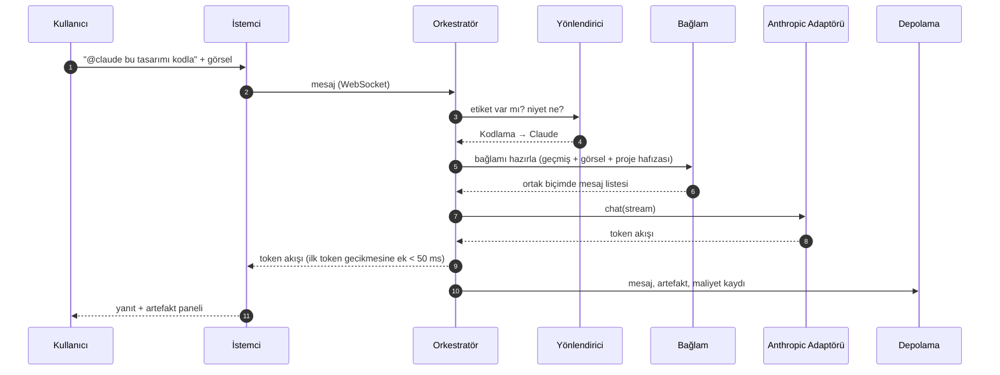

<div align="center">

# SYMFORYX

### Tüm yapay zekâ modellerin ve araçların tek sohbette, uyum içinde çalışır

*Bir **ozkandev** projesi*

`Ürün Tasarım Dokümanı v1.0` · `Durum: Spesifikasyon` · `Dil: Türkçe`

</div>

---

> **Bu doküman nedir?**
> SYMFORYX'in ne olduğunu, nasıl kullanılacağını ve nasıl inşa edileceğini anlatan tek kaynaktır. Ürün vizyonu, kullanıcı kılavuzu, arayüz tasarımı, mimari, performans hedefleri ve yol haritası burada yer alır.
> Kurulum komutları, adresler ve ekran metinleri **hedeflenen davranışı** tanımlar. Uygulama geliştirildikçe bu doküman da güncellenir.

---

## İçindekiler

**Bölüm I — Ürün**

1. [SYMFORYX nedir?](#1-symforyx-nedir)
2. [İsmin anlamı](#2-ismin-anlamı)
3. [Temel ilkeler](#3-temel-ilkeler)
4. [Kimler için?](#4-kimler-için)
5. [Temel kavramlar](#5-temel-kavramlar)

**Bölüm II — Özellikler**
6. [Tek sohbet, birden çok model](#6-tek-sohbet-birden-çok-model)
7. [Çalışma modları](#7-çalışma-modları)
8. [Görev rolleri: hangi iş, hangi model?](#8-görev-rolleri-hangi-iş-hangi-model)
9. [Araç ekosistemi](#9-araç-ekosistemi)
10. [Akışlar (Flows)](#10-akışlar-flows)
11. [Artefakt paneli](#11-artefakt-paneli)
12. [Bağlam ve hafıza](#12-bağlam-ve-hafıza)
13. [Maliyet yönetimi](#13-maliyet-yönetimi)

**Bölüm III — Arayüz**
14. [Tasarım ilkeleri](#14-tasarım-ilkeleri)
15. [Ekran düzeni](#15-ekran-düzeni)
16. [Mesaj kutusu (Composer)](#16-mesaj-kutusu-composer)
17. [Basit Mod ve Uzman Mod](#17-basit-mod-ve-uzman-mod)
18. [Komutlar ve klavye kısayolları](#18-komutlar-ve-klavye-kısayolları)
19. [Görsel kimlik](#19-görsel-kimlik)

**Bölüm IV — Kullanım Kılavuzu**
20. [Kurulum seçenekleri](#20-kurulum-seçenekleri)
21. [İlk açılış sihirbazı](#21-i̇lk-açılış-sihirbazı)
22. [5 dakikada başlangıç](#22-5-dakikada-başlangıç)
23. [Adım adım rehberler](#23-adım-adım-rehberler)
24. [Hazır kullanım senaryoları](#24-hazır-kullanım-senaryoları)
25. [Ayarlar referansı](#25-ayarlar-referansı)

**Bölüm V — Teknik**
26. [Mimari](#26-mimari)
27. [Teknoloji seçimleri](#27-teknoloji-seçimleri)
28. [Sağlayıcı adaptörleri](#28-sağlayıcı-adaptörleri)
29. [Araç manifestosu ve SDK](#29-araç-manifestosu-ve-sdk)
30. [Akıllı yönlendirici](#30-akıllı-yönlendirici)
31. [Performans](#31-performans)
32. [Güvenlik ve gizlilik](#32-güvenlik-ve-gizlilik)
33. [API, CLI ve Webhook](#33-api-cli-ve-webhook)
34. [Proje klasör yapısı](#34-proje-klasör-yapısı)

**Bölüm VI — Yol Haritası ve Destek**
35. [Yol haritası](#35-yol-haritası)
36. [Sıkça sorulan sorular](#36-sıkça-sorulan-sorular)
37. [Sorun giderme](#37-sorun-giderme)
38. [Sözlük](#38-sözlük)
39. [Katkı, lisans ve emeği geçenler](#39-katkı-lisans-ve-emeği-geçenler)

---

## Bu dokümanı nasıl okumalısın?

| Sen kimsin? | Okuman gereken bölümler |
| --- | --- |
| Sadece kullanmak istiyorum | 1, 6, 7, 8 ve **Bölüm IV** |
| Ürünü değerlendiriyorum | **Bölüm I**, **Bölüm II**, 35 |
| Tasarımcıyım | **Bölüm III** |
| Geliştiriciyim | **Bölüm V**, 29, 33 |
| Araç (plugin) yazmak istiyorum | 9, 29, 33 |

---

# BÖLÜM I — ÜRÜN

## 1. SYMFORYX nedir?

SYMFORYX, farklı yapay zekâ modellerini ve araçlarını **tek bir sohbet ekranında** birlikte kullanmanı sağlayan bir yapay zekâ çalışma alanıdır.

Bugün çoğu insan şöyle çalışıyor: görseli bir sekmede üretiyor, indiriyor, başka bir sekmeye yüklüyor, kodu orada yazdırıyor, hatayı üçüncü bir yerde arıyor ve her seferinde bağlamı baştan anlatıyor. SYMFORYX bu kopyala-yapıştır döngüsünü ortadan kaldırır.

```
Eskiden:   [Görsel aracı] → indir → [Kod aracı] → kopyala → [Arama] → yapıştır → ...
SYMFORYX:  Tek sohbet → @gorsel tasarla → @claude kodla → /ara hatayı bul → önizle
```

**SYMFORYX sadece "ChatGPT + Claude" değildir.** Herhangi bir dil modelini, görsel/ses/video üreticisini, web aramasını, kod çalıştırma ortamını, GitHub'ı, Figma'yı, veritabanlarını, otomasyon servislerini ve MCP uyumlu her aracı aynı sohbete bağlayabilirsin. Hangi işi hangi modelin ya da aracın yapacağına **sen karar verirsin**. İstersen bu kararı SYMFORYX'e de bırakabilirsin.

### Bir bakışta

| Ne yapar? | Nasıl? |
| --- | --- |
| Birden çok modeli tek sohbette kullanır | `@claude`, `@gpt`, `@gemini`, `@yerel` gibi etiketlerle |
| Görsel, ses ve video üretir | `@gorsel`, `/ses`, `/video` ile |
| Kod yazar, çalıştırır, önizler | Artefakt paneli ve güvenli kod ortamı (sandbox) ile |
| İşleri modeller arasında aktarır | Tek tıkla "Sonraki modele gönder" |
| Tekrarlanan işleri otomatikleştirir | Akışlar (Flows) ile |
| Yeni araçlarla genişler | Araç Mağazası, MCP ve SDK ile |
| Harcamanı kontrol eder | Mesaj başına maliyet, bütçe limitleri |
| Verilerini korur | Anahtarlar cihazda şifreli, yerel öncelikli mimari |

---

## 2. İsmin anlamı

**SYMFORYX** üç parçadan oluşur:

- **SYM**phony (senfoni): Farklı enstrümanların tek bir eser için uyum içinde çalması. Burada enstrümanlar modeller ve araçlardır.
- **FOR**ge (demirhane, dövmek): Fikri işlenmiş bir ürüne dönüştürmek. Görsel, kod, doküman, uygulama.
- **X**: Sınırsız genişletilebilirlik. Her yeni araç orkestraya yeni bir enstrüman olarak katılır.

> Sen şefsin. Modeller ve araçlar orkestra.

---

## 3. Temel ilkeler

Her tasarım ve mühendislik kararı bu altı ilkeyle sınanır. İki ilke çatışırsa sıralamadaki üstteki kazanır.

| # | İlke | Anlamı | Pratikte |
| --- | --- | --- | --- |
| 1 | **Kontrol sende** | Kullanıcı her şeyi seçebilir; hiçbir şey dayatılmaz | Her otomatik karar görünür ve tek tıkla değiştirilebilir |
| 2 | **Önce güvenlik** | Anahtarlar, dosyalar ve veriler korunur | Araçlar izin ister, riskli işlemler onay ister |
| 3 | **Sadelik** | İlk kullanımda karmaşa yok | Basit Mod varsayılan; gelişmiş özellikler gerektiğinde açılır |
| 4 | **Hız** | Arayüz asla beklemez | Akış (streaming), anında tepki, 60 FPS |
| 5 | **Açıklık** | Her şey genişletilebilir | Açık araç standardı, MCP desteği, herkese açık API |
| 6 | **Şeffaflık** | Ne olduğu ve ne kadar tuttuğu her zaman bilinir | Her mesajda model, süre ve maliyet görünür |

---

## 4. Kimler için?

| Kullanıcı | İhtiyacı | SYMFORYX'te nasıl çalışır? |
| --- | --- | --- |
| **Bağımsız geliştirici** | Tasarımı görmek ve hızlıca kodlamak | Görsel üret → Claude'a gönder → canlı önizle |
| **Tasarımcı** | Fikirleri hızlı denemek, geliştiriciye teslim | Paralel görsel varyasyonlar, Figma aracı |
| **İçerik üreticisi** | Yazı + kapak görseli + sosyal medya metni | "İçerik Kiti" akışı tek tıkla |
| **Öğrenci / araştırmacı** | Kaynaklı araştırma, özet | Web araması + dosya analizi + rapor |
| **Ekip / şirket** | Ortak çalışma alanı, maliyet kontrolü | Sunucu modu, roller, bütçeler, denetim kaydı |
| **Gizlilik odaklı kullanıcı** | Verilerin cihazdan çıkmaması | Tamamen yerel modeller (Ollama vb.) |

---

## 5. Temel kavramlar

Arayüzde ve bu dokümanda kullanılan kelimelerin hepsi aşağıdadır. Bunları bilen herkes SYMFORYX'i rahatça kullanır.

| Kavram | Açıklama | Örnek |
| --- | --- | --- |
| **Çalışma Alanı** | Tüm projelerin, ayarların ve anahtarların bulunduğu en üst katman | "Kişisel", "Şirket" |
| **Proje** | Birbiriyle ilişkili sohbetlerin, dosyaların ve hafızanın klasörü | "E-Ticaret Sitesi" |
| **Sohbet** | Mesajlaşma akışı. İçinde birden çok model ve araç bulunabilir | "Ana sayfa tasarımı" |
| **Sağlayıcı** | Model veya hizmet sunan şirket ya da yazılım | OpenAI, Anthropic, Google, Ollama |
| **Model** | Sağlayıcının sunduğu belirli yapay zekâ | Bir Claude modeli, bir GPT modeli |
| **Araç** | Modelin dışında iş yapan yetenek | Web araması, kod çalıştırma, GitHub |
| **Rol** | Bir iş türüne atadığın varsayılan model veya araç | Kodlama → Claude |
| **Etiket (Mention)** | Mesajı belirli bir model veya araca yönlendirme | `@claude`, `@gorsel` |
| **Komut** | `/` ile başlayan hızlı işlem | `/ara`, `/ozetle` |
| **Akış** | Birden çok adımı sırayla veya paralel çalıştıran tarif | "Tasarımdan Koda" |
| **Ajan** | Hedefi verip araçları kendi kullanmasına izin verdiğin mod | "Bu hatayı bul ve düzelt" |
| **Artefakt** | Sohbetten çıkan kalıcı ürün | Görsel, kod dosyası, doküman |
| **Bağlam** | Modelin yanıt verirken gördüğü bilgi | Önceki mesajlar, dosyalar, hafıza |
| **Anahtar Kasası** | API anahtarlarının şifreli saklandığı yer | OpenAI anahtarı |

---

# BÖLÜM II — ÖZELLİKLER

## 6. Tek sohbet, birden çok model

SYMFORYX'in kalbi tek sohbet içinde birden çok modelin birlikte çalışmasıdır. Bunu dört yolla yapabilirsin. Hangisi rahatına gelirse onu kullan.

### 6.1 Etiketle (`@`)

Mesajın başına veya içine etiket yaz:

```
@gorsel minimalist, açık renkli bir kahve dükkânı ana sayfası tasarla
@claude yukarıdaki tasarımı React ve Tailwind ile kodla
@gpt bu sayfa için 3 farklı slogan öner
@herkes bu üç slogandan hangisi daha iyi? Gerekçeyle cevap ver
```

| Etiket | Ne yapar? |
| --- | --- |
| `@claude`, `@gpt`, `@gemini`, `@yerel` | Mesajı o sağlayıcının varsayılan modeline gönderir |
| `@gorsel` (veya `@görsel`) | Görsel üretim rolüne atanmış araca gönderir |
| `@kod`, `@yazi`, `@arastirma` | İlgili role atanmış modele gönderir |
| `@herkes` | Mesajı seçili tüm modellere paralel gönderir |
| `@<takma-ad>` | Senin oluşturduğun takma ada gönderir (ör. `@tasarimci`) |

> **İpucu:** `@` yazınca otomatik tamamlama açılır. Ok tuşlarıyla seç, Enter'a bas.

### 6.2 Model seçiciyle

Mesaj kutusunun altındaki model çipine tıkla ve bu mesaj için model seç. Seçim sadece o mesaj için geçerlidir; sohbetin varsayılanı değişmez. Kalıcı yapmak için çipin yanındaki raptiye simgesine tıkla.

### 6.3 Aktararak

Her yanıtın altında **"Gönder ▸"** düğmesi bulunur. Tıklayınca o yanıtı (görsel, kod veya metin) seçtiğin başka bir modele girdi olarak gönderir.

```
[Görsel yanıt]  ↳ Claude'a gönder: "Bunu kodla"   ↳ GPT'ye gönder: "Bunu eleştir"
```

Aktarma sırasında SYMFORYX:

- Görseli, hedef model görsel okuyabiliyorsa doğrudan ekler; okuyamıyorsa önce görseli metne dönüştürür ve bunu sana söyler.
- Aktarımla ilgili kısa bir not ekler: "Bu görsel @gorsel tarafından şu istekle üretildi: ...".
- Hazır bir yönerge önerir. Önerinin metnini düzenleyebilirsin.

### 6.4 Otomatik bırakarak

Etiket yazmazsan ve mod **Akıllı** ise yönlendirici isteğini anlar, uygun rolü seçer ve yanıtın başında hangi modeli neden seçtiğini kısaca gösterir:

```
Akıllı yönlendirme: Kodlama → Claude  (neden? "kodla" ifadesi ve ekli görsel)  [Değiştir]
```

### Ortak sohbet geçmişi

Bir sohbetteki tüm modeller aynı geçmişi görür. Claude, GPT'nin önceki yanıtını; GPT, Claude'un yazdığı kodu bilir. SYMFORYX her sağlayıcının mesaj biçimini ortak bir biçime çevirir ve hangi mesajı hangi modelin yazdığını korur.

İstersen bu davranışı **Ayarlar → Sohbet → Ortak bağlam** altından değiştirebilirsin:

| Seçenek | Davranış |
| --- | --- |
| **Tam paylaşım** (varsayılan) | Her model tüm sohbeti görür |
| **Sadece kendi + kullanıcı** | Model sadece kendi yanıtlarını ve senin mesajlarını görür |
| **Sadece aktarılan** | Model sadece açıkça aktardığın içeriği görür |

---

## 7. Çalışma modları

Modu mesaj kutusunun solundaki **mod çipinden** seçersin. Her sohbet kendi modunu hatırlar.

| Mod | Ne zaman kullanılır? | Kim karar verir? |
| --- | --- | --- |
| **Manuel** | Hangi modeli istediğini tam biliyorsan | Sen |
| **Akıllı** (varsayılan) | Model düşünmek istemiyorsan | SYMFORYX önerir, sen onaylarsın |
| **Zincir** | Bir çıktının bir sonraki modele girdi olması gerekiyorsa | Senin tanımladığın sıra |
| **Karşılaştır** | Aynı soruya farklı modellerin cevabını görmek istiyorsan | Sen seçersin |
| **Konsey** | Kaliteyi artırmak için modellerin birbirini denetlemesini istiyorsan | Modeller tartışır, hakem birleştirir |
| **Ajan** | Hedefi verip adımları ona bırakmak istiyorsan | Ajan planlar, kritik adımlarda sana sorar |

### 7.1 Manuel

Mesaj her zaman seçili modele gider. Etiketler yine çalışır.

### 7.2 Akıllı

Yönlendirici isteğin türünü (kod, görsel, araştırma, yazı...) belirler ve **Görev Rolleri** tablosundaki atamaya göre model seçer. Seçim belirsizse sana iki seçenek sunar. Yönlendirme çok hızlıdır ve sohbeti yavaşlatmaz (bkz. [Bölüm 30](#30-akıllı-yönlendirici)).

### 7.3 Zincir

Adımları sohbet içinde yazarak kurarsın:

```
/zincir @gorsel mobil uygulama giriş ekranı tasarla
      > @claude bunu SwiftUI ile kodla
      > @gpt kodu erişilebilirlik açısından incele
```

Her adımın çıktısı bir sonrakine otomatik girdi olur. Herhangi bir adımda durup düzenleyebilirsin. Sık kullandığın zinciri **"Akış olarak kaydet"** ile kalıcı hale getirebilirsin.

### 7.4 Karşılaştır

Mesaj birden çok modele aynı anda gider. Yanıtlar yan yana sütunlarda akar.

```
┌─────────────────────┬─────────────────────┬─────────────────────┐
│ Claude   4.1 sn     │ GPT      3.6 sn     │ Gemini   3.9 sn     │
│ ...                 │ ...                 │ ...                 │
│ [Bunu seç]          │ [Bunu seç]          │ [Bunu seç]          │
└─────────────────────┴─────────────────────┴─────────────────────┘
```

"Bunu seç" dediğin yanıt sohbetin ana dalına eklenir. Diğerleri dal olarak saklanır ve kaybolmaz.

### 7.5 Konsey

1. **Üretici** model ilk yanıtı yazar.
2. **Eleştirmen** modeller yanıtı inceler: hata, eksik, iyileştirme.
3. **Hakem** model eleştirileri değerlendirip son yanıtı yazar.

Rolleri sen atarsın. Konsey modu daha fazla çağrı yaptığı için tahmini maliyeti gönderimden önce gösterir.

### 7.6 Ajan

Bir hedef verirsin: *"Bu projedeki giriş hatasını bul, düzelt ve testleri çalıştır."* Ajan:

1. Bir plan çıkarır ve sana gösterir.
2. Araçları (dosya okuma, kod çalıştırma, web araması, GitHub...) kullanarak adım adım ilerler.
3. **Kritik işlemlerden önce** (dosya silme, kod gönderme, ücretli işlem, dış servise yazma) onay ister.
4. Her adımı canlı bir zaman çizelgesinde gösterir. İstediğin an durdurabilirsin.

Ajanın sınırlarını **Ayarlar → Ajan** altında belirlersin: en fazla adım sayısı, en fazla harcama, izinli araçlar.

---

## 8. Görev rolleri: hangi iş, hangi model?

SYMFORYX'te model adlarını ezberlemen gerekmez. **İş türünü** bir modele veya araca bir kez atarsın, sonra sadece işi söylersin.

**Ayarlar → Görev Rolleri** ekranı:

| Rol | Ne için? | Örnek atama | Yedek |
| --- | --- | --- | --- |
| **Genel sohbet** | Gündelik sorular | GPT | Gemini |
| **Kodlama** | Kod yazma, hata ayıklama, refactor | Claude | GPT |
| **Görsel üretim** | Sıfırdan görsel | OpenAI görsel modeli | Flux |
| **Görsel düzenleme** | Var olan görseli değiştirme | OpenAI görsel düzenleme | Stability |
| **Yazı** | Makale, e-posta, metin | Claude | GPT |
| **Araştırma** | Kaynaklı bilgi | Web Araması + Gemini | Web Araması + GPT |
| **Veri analizi** | CSV, tablo, grafik | Claude + Kod Çalıştırma | GPT + Kod Çalıştırma |
| **Ses** | Metni sese, sesi metne çevirme | ElevenLabs / Whisper | Yerel Whisper |
| **Video** | Kısa video üretimi | Seçtiğin video aracı | — |
| **Özetleme** | Uzun içerikleri kısaltma | Hızlı ve ucuz bir model | Yerel model |

- Tablodaki atamalar **sadece örnektir.** İlk açılışta bağladığın sağlayıcılara göre öneri gelir; hepsini değiştirebilirsin.
- **Yedek**, birincil model hata verirse veya ulaşılamazsa otomatik kullanılır. Yedeğe geçiş her zaman mesajda belirtilir.
- **Proje bazında geçersiz kılma:** Bir proje için farklı roller tanımlayabilirsin. Örneğin "Mobil Uygulama" projesinde Kodlama rolü başka bir modele atanabilir.
- **Kendi rolünü oluştur:** "Hukuki inceleme", "SEO metni" gibi roller ekleyip kendine özel sistem yönergesi ve model atayabilirsin.

---

## 9. Araç ekosistemi

Araçlar SYMFORYX'i sohbet uygulamasından gerçek bir çalışma ortamına dönüştürür. Her araç bir **enstrümandır**: istediğini ekler, istemediğini kaldırırsın.

### 9.1 Araç kategorileri

| Kategori | Ne yapar? | Örnek araçlar |
| --- | --- | --- |
| **Dil modelleri** | Sohbet, yazı, kod, akıl yürütme | OpenAI, Anthropic, Google, Mistral, DeepSeek, OpenRouter |
| **Yerel modeller** | İnternetsiz, ücretsiz çalışma | Ollama, LM Studio, llama.cpp |
| **Görsel üretim** | Metinden görsel | OpenAI görsel modelleri, Flux, Stability, Ideogram, yerel ComfyUI |
| **Görsel düzenleme** | Arka plan silme, büyütme, düzenleme | Görsel düzenleme API'leri, yerel araçlar |
| **Ses** | Metinden sese, sesten metne | ElevenLabs, Whisper, yerel TTS |
| **Video** | Metinden veya görselden video | Seçilen video üretim API'leri |
| **Web** | Arama, sayfa okuma | Tavily, Brave Search, SearXNG (kendi sunucunda) |
| **Dosya ve bilgi** | PDF, Word, Excel okuma; belge içinde arama | Yerleşik dosya okuyucu ve vektör arama |
| **Kod çalıştırma** | Python ve JavaScript'i güvenli ortamda çalıştırma | Yerleşik sandbox |
| **Canlı önizleme** | HTML/React kodunu anında görüntüleme | Yerleşik önizleyici |
| **Geliştirici** | Depo, issue, PR yönetimi | GitHub, GitLab |
| **Tasarım** | Tasarım dosyalarını okuma ve yazma | Figma, renk paleti araçları |
| **Veri** | Sorgu çalıştırma, tablo analizi | PostgreSQL, MySQL, SQLite, Google Sheets |
| **Verimlilik** | Doküman, not, mesaj | Google Drive, Notion, Slack, Takvim, E-posta |
| **Otomasyon** | Dış sistemleri tetikleme | Webhook, n8n, Zapier, Make |
| **MCP sunucuları** | MCP standardını destekleyen her araç | Topluluk ve kurumsal MCP sunucuları |

### 9.2 Araç türleri (teknik)

| Tür | Açıklama | Kim ekler? |
| --- | --- | --- |
| **Yerleşik** | SYMFORYX ile birlikte gelir | Hazır |
| **MCP** | Model Context Protocol sunucusu; adres veya komutla bağlanır | Kullanıcı |
| **OpenAPI** | OpenAPI şeması olan her REST API'si otomatik araca dönüşür | Kullanıcı |
| **HTTP** | Tek bir uç nokta için basit tanım | Kullanıcı |
| **Betik** | Kendi yazdığın JS/Python fonksiyonu, sandbox'ta çalışır | Kullanıcı / geliştirici |

### 9.3 Araç Mağazası

**Araçlar → Mağaza** ekranında:

- Kategoriye, popülerliğe ve "Ücretsiz / Ücretli API gerektirir / Yerel" filtrelerine göre arama yapılır.
- Her aracın kartında izinler, yaklaşık maliyet, son güncelleme, doğrulanmış yayıncı rozeti ve kullanıcı puanı görünür.
- **Tek tıkla kur.** Kurulumda araç istediği izinleri listeler; sen onaylarsın.
- Kurulan araçlar sürüm kontrolüyle güncellenir. İzinleri değişen bir güncelleme **tekrar onay** ister.

### 9.4 Araç izinleri

Telefon uygulamalarındaki izin sistemine benzer. Her araç neye eriştiğini açıkça bildirir:

| İzin | Örnek |
| --- | --- |
| Ağ erişimi | Sadece `api.openai.com` alan adına |
| Dosya erişimi | Sadece bu projenin klasörü, salt okunur |
| Gizli anahtar | `OPENAI_API_KEY` |
| Ücretli işlem | Çağrı başına yaklaşık maliyet |
| Dış sisteme yazma | GitHub'a commit, e-posta gönderme |

Her izin için seçeneklerin:

```
( ) Her seferinde sor    ( ) Bu sohbette izin ver    ( ) Bu projede izin ver    ( ) Her zaman izin ver    ( ) Engelle
```

**Varsayılan kural:** Okuma işlemleri bir kez onaylanır. Yazma, silme, gönderme ve ödeme işlemleri **her seferinde** onay ister. Kullanıcı bunu bilerek değiştirebilir.

### 9.5 Araçları sohbette kullanmak

- **Otomatik:** Model gerektiğinde açık olan araçları kendisi çağırır. Araç çağrısı mesajda katlanabilir bir kart olarak görünür.
- **Elle:** Mesaj kutusundaki **Araçlar** çipinden bu mesaj için hangi araçların açık olacağını seçersin.
- **Komutla:** `/ara`, `/calistir`, `/github` gibi komutlar ilgili aracı doğrudan çağırır.

```
▸ Araç: Web Araması  ·  "React 19 form actions"  ·  5 sonuç  ·  0.8 sn   [Detay]
```

---

## 10. Akışlar (Flows)

Akış, sık yaptığın çok adımlı bir işi **tek tıkla** çalıştırmanı sağlayan tariftir.

### 10.1 Akış nasıl oluşturulur?

Üç yol vardır:

1. **Sohbetten kaydet:** Başarılı bir zinciri tamamladıktan sonra "Akış olarak kaydet" de. SYMFORYX adımları otomatik çıkarır.
2. **Görsel düzenleyici:** **Akışlar → Yeni** ekranında kutuları sürükleyip birbirine bağla.
3. **Dosya ile:** YAML olarak yaz veya içe aktar (geliştiriciler için).

### 10.2 Adım türleri

| Adım | Ne yapar? |
| --- | --- |
| **Model** | Bir modele veya role yönerge gönderir |
| **Araç** | Bir aracı çalıştırır |
| **Onay** | Durur ve senden onay bekler |
| **Koşul** | Sonuca göre farklı dala gider |
| **Paralel** | Birden çok adımı aynı anda çalıştırır |
| **Döngü** | Bir listedeki her öğe için adımları tekrarlar |
| **Girdi** | Kullanıcıdan bilgi ister (metin, dosya, seçim) |
| **Çıktı** | Sonucu artefakt, dosya veya webhook olarak teslim eder |

### 10.3 Örnek: "Tasarımdan Koda" akışı



```yaml
id: tasarimdan-koda
name: Tasarımdan Koda
description: Bir fikirden tasarım üretir, onayından sonra kodlar ve önizler.
inputs:
  brief:
    type: text
    label: "Ne tasarlayalım?"
    placeholder: "Ör. kahve dükkânı için sade bir ana sayfa"
  framework:
    type: select
    label: "Çatı"
    options: [React + Tailwind, Vue, Svelte, Saf HTML/CSS]
    default: React + Tailwind
steps:
  - id: tasarim
    use: role:gorsel-uretim
    prompt: "{{brief}} için modern, temiz ve erişilebilir bir arayüz tasarımı oluştur."
  - id: onay
    type: approval
    message: "Tasarım uygun mu? Değilse ne değişsin?"
    on_reject: { goto: tasarim, feedback: true }
  - id: kod
    use: role:kodlama
    attach: [tasarim.image]
    prompt: "Bu tasarımı {{framework}} ile birebir kodla. Bileşenlere ayır, mobil uyumlu yap."
  - id: onizleme
    use: tool:canli-onizleme
    input: kod.files
outputs: [tasarim.image, kod.files, onizleme.url]
budget:
  max_cost_usd: 1.00
```

### 10.4 Hazır akış şablonları

| Akış | Adımlar |
| --- | --- |
| **Tasarımdan Koda** | Görsel → onay → kod → önizleme |
| **İçerik Kiti** | Konu → makale → kapak görseli → 5 sosyal medya metni |
| **Hata Avcısı** | Log/hata → web araması → kök neden → düzeltme önerisi → test |
| **Araştırma Raporu** | Soru → çoklu web araması → kaynak özeti → kaynaklı rapor |
| **Mağaza Görselleri** | Uygulama açıklaması → ekran görüntüsü tasarımları → mağaza metinleri |
| **Veri Analizi** | CSV → temizleme → analiz → grafik → yorum |
| **Kod İncelemesi** | GitHub PR → iki model bağımsız inceler → hakem birleştirir |
| **Logo Keşfi** | Marka tanımı → 4 paralel varyasyon → seçim → renk paleti |

### 10.5 Akışları tetikleme

- Sohbette `/akis tasarimdan-koda` yazarak
- Akışlar ekranındaki **Çalıştır** düğmesiyle
- **Zamanlanmış:** "Her pazartesi 09:00" (sunucu veya açık masaüstü uygulaması gerekir)
- **Webhook:** Dış bir sistem akışı başlatabilir
- **CLI:** `symforyx flow run tasarimdan-koda --brief "..."`

---

## 11. Artefakt paneli

Sohbetten çıkan her kalıcı ürün sağdaki **Artefakt panelinde** açılır. Sohbet akmaya devam ederken ürün sabit durur.

| Artefakt türü | Panelde ne yapabilirsin? |
| --- | --- |
| **Görsel** | Yakınlaştır, karşılaştır, sürümler arası geçiş, düzenleme iste, indir (PNG/JPG/WebP) |
| **Kod** | Çok dosyalı ağaç görünümü, sözdizimi renklendirme, fark (diff) görünümü, düzenle, kopyala, ZIP indir |
| **Canlı önizleme** | HTML/React/Vue çıktısını anında çalıştır; masaüstü/tablet/mobil boyutları |
| **Doküman** | Markdown görüntüle ve düzenle, PDF/DOCX/MD dışa aktar |
| **Tablo** | Sırala, filtrele, CSV/XLSX indir |
| **Grafik** | Etkileşimli grafik, PNG/SVG indir |
| **Ses / Video** | Oynatıcı, indir |
| **Diyagram** | Mermaid diyagramlarını görüntüle, SVG indir |

**Sürümleme:** Bir artefaktta yapılan her değişiklik yeni sürüm oluşturur (`v1`, `v2`, `v3`...). Sürümler arasında geçiş yapabilir, iki sürümü yan yana karşılaştırabilir ve eski sürüme dönebilirsin.

**Seçip sor:** Artefaktın bir bölümünü (kod satırları, görselin bir alanı) seçip "Bunu değiştir" diyebilirsin. Seçim mesajına bağlam olarak eklenir.

**Dışa gönder:** Kodu GitHub'a gönder, görseli Figma'ya aktar, dokümanı Google Drive'a kaydet (ilgili araçlar kuruluysa).

---

## 12. Bağlam ve hafıza

### 12.1 Sohbet asla "bağlam doldu" diye bitmez

Uzun sohbetlerde modellerin bağlam kapasitesi dolar. Bu durumda pek çok uygulama yeni sohbet açmanı ister. SYMFORYX bunu kendi çözer:

- Mesaj kutusunun üstünde ince bir **bağlam çubuğu** doluluk oranını gösterir.
- %80'e ulaşınca eski mesajlar **arka planda özetlenir**. Özet, sohbetin başında katlanabilir bir kart olarak görünür.
- Önemli mesajları **sabitleyebilirsin** (raptiye). Sabitlenen mesajlar asla özetlenmez.
- Model değiştirdiğinde daha küçük bağlamlı bir modele geçiyorsan SYMFORYX bunu söyler ve gerekeni otomatik kırpar.

```
Bağlam  ████████████░░░░  %74   ·  3 sabit mesaj  ·  1 özet   [Yönet]
```

### 12.2 Proje hafızası

Her projenin kalıcı bir hafızası vardır ve projedeki tüm sohbetler buna erişir:

- **Talimatlar:** "Bu projede TypeScript ve Tailwind kullanılıyor. Türkçe yorum yaz."
- **Dosyalar:** Yüklenen belgeler otomatik indekslenir; modeller ilgili bölümleri bulup kullanır.
- **Notlar:** Sohbetten "Hafızaya ekle" diyerek kaydedilen bilgiler.

### 12.3 Kişisel hafıza

**Ayarlar → Hafıza** altında:

- **Hakkımda:** Tüm sohbetlerde geçerli tercihler (ör. "Kısa ve net cevaplar seviyorum").
- **Otomatik öneri:** SYMFORYX kalıcı olabilecek bilgileri **önerir**, sen onaylamazsan kaydetmez.
- Hafızadaki her kaydı görebilir, düzenleyebilir ve silebilirsin. Hafızayı tamamen kapatabilirsin.

### 12.4 Dallandırma

Herhangi bir mesajdan **dal** oluşturabilirsin. Ana sohbet bozulmadan farklı bir yönü denersin. Dallar sohbet başlığının yanındaki ağaç simgesinden gezilir.

---

## 13. Maliyet yönetimi

SYMFORYX, API anahtarlarınla çalışır (**BYOK — Kendi anahtarını getir**). Ödemeyi doğrudan sağlayıcıya yaparsın; SYMFORYX araya ücret eklemez.

> **Önemli:** ChatGPT veya Claude gibi uygulamaların tüketici abonelikleri genellikle API erişimini kapsamaz. API kullanımı sağlayıcı tarafından ayrıca ücretlendirilir. Güncel fiyatlar için sağlayıcının fiyat sayfasına bak. Hiç ücret ödemek istemiyorsan [yerel modelleri](#235-yerel-ücretsiz-model-ekle) kullanabilirsin.

### 13.1 Maliyet her zaman görünür

- Her yanıtın altında: **model · süre · giriş/çıkış token · tahmini maliyet**
- Gönderimden önce (isteğe bağlı): **tahmini maliyet** göstergesi
- Kenar çubuğunun altında: **bu ayki harcama / bütçe**

### 13.2 Bütçeler

| Bütçe türü | Davranış |
| --- | --- |
| **Yumuşak limit** | Eşiğe ulaşınca uyarır (ör. %80) |
| **Sert limit** | Limite ulaşınca ücretli çağrıları durdurur; yerel modeller çalışmaya devam eder |
| **Sohbet / akış limiti** | Tek bir sohbet veya akış çalıştırması için üst sınır |
| **Ajan limiti** | Ajan modunda bir görev için en fazla harcama |

Bütçeler çalışma alanı, proje veya sağlayıcı bazında tanımlanabilir.

### 13.3 Tasarruf seçenekleri

- **Ekonomi Modu:** Basit soruları (selamlaşma, kısa bilgi) otomatik olarak ucuz veya yerel modele yönlendirir.
- **Önbellek:** Aynı istek tekrarlandığında önceki yanıtı kullanmayı önerir. Sağlayıcı istem önbelleklemesini (prompt caching) destekliyorsa otomatik kullanır.
- **Bağlam kırpma:** Gereksiz uzun geçmişi göndermemek için akıllı özetleme.

### 13.4 Kullanım paneli

**Ayarlar → Kullanım** ekranında günlük, haftalık ve aylık harcama; model, sağlayıcı, proje ve araç kırılımı; en pahalı 10 sohbet ve CSV dışa aktarma bulunur.

---

# BÖLÜM III — ARAYÜZ

## 14. Tasarım ilkeleri

1. **Sohbet merkezdedir.** Ekranın en geniş alanı her zaman sohbettir. Diğer her şey ikincildir ve gizlenebilir.
2. **Üç tık kuralı.** Hiçbir sık kullanılan işlem üç tıktan fazla gerektirmez. Ctrl+K ile her şeye bir tıkla ulaşılır.
3. **Aşamalı gösterim.** Gelişmiş seçenekler ihtiyaç duyulduğunda görünür. Yeni kullanıcı boğulmaz, uzman kullanıcı kısıtlanmaz.
4. **Her şey geri alınabilir.** Silinen sohbet 30 gün çöp kutusunda kalır. Artefaktlar sürümlüdür. Ayarlar varsayılana döndürülebilir.
5. **Durum her zaman bellidir.** Hangi model çalışıyor, hangi araç çağrılıyor, ne kadar sürdü, ne kadar tuttu; hepsi görünür.
6. **Boş ekran yoktur.** İlk açılışta ve boş projelerde örnek yönergeler ve hazır akışlar önerilir.
7. **Klavye birinci sınıf vatandaştır.** Her işlem fareyle de klavyeyle de yapılabilir.
8. **Herkes için erişilebilir.** WCAG 2.2 AA uyumu, ekran okuyucu desteği, yüksek kontrast teması, azaltılmış hareket desteği.

---

## 15. Ekran düzeni

### 15.1 Ana ekran (masaüstü)

<<WIREFRAME_MAIN>>

| Alan | İçerik | Gizlenebilir mi? |
| --- | --- | --- |
| **Sol kenar çubuğu** | Projeler, sohbetler, akışlar, araçlar, harcama özeti | Evet (Ctrl+B) |
| **Orta alan** | Sohbet ve mesaj kutusu | Hayır |
| **Sağ panel** | Artefaktlar | Evet (Ctrl+Shift+A); artefakt yoksa otomatik kapalı |
| **Üst çubuk** | Proje adı, komut paleti, ayarlar | Hayır |

### 15.2 Mesaj kartı

<<WIREFRAME_MESSAGE>>

- **Model rozeti:** Her sağlayıcının kendi rengi ve harfi vardır. Renkler kullanıcı tarafından değiştirilebilir.
- **Gönder ▸:** Yanıtı başka bir modele aktarır.
- **Yeniden:** Aynı istekle veya farklı bir modelle yeniden üretir. Eski yanıt kaybolmaz; `1/2` gibi gezinilir.
- **Dallan:** Bu noktadan yeni bir dal açar.
- **Menü (...):** Kopyala, hafızaya ekle, akışa dönüştür, sil, ham veriyi görüntüle.

### 15.3 Duyarlı tasarım

| Ekran | Düzen |
| --- | --- |
| **Geniş (> 1280 px)** | Üç sütun: kenar çubuğu + sohbet + artefakt |
| **Orta (768–1280 px)** | Kenar çubuğu daralır (simgeler); artefakt paneli sohbetin üstüne kayar |
| **Mobil (< 768 px)** | Tek sütun; kenar çubuğu soldan çekmece, artefaktlar tam ekran sayfa; mesaj kutusu alta sabit |

### 15.4 Durum ekranları

| Durum | Ne görünür? |
| --- | --- |
| **Boş sohbet** | Proje adı, 4 örnek yönerge kartı, hazır akış önerileri |
| **Yanıt bekleniyor** | Model rozeti + yanıp sönen imleç; araç çağrısı varsa araç kartı |
| **Hata** | Kırmızı ince çerçeve, anlaşılır Türkçe açıklama, "Tekrar dene" ve "Yedek modelle dene" düğmeleri |
| **Çevrimdışı** | Üstte ince uyarı; yerel modeller çalışmaya devam eder, bulut mesajları kuyruğa alınır |
| **Bütçe doldu** | Mesaj kutusunun üstünde bilgi; "Limiti artır" ve "Yerel modele geç" seçenekleri |

---

## 16. Mesaj kutusu (Composer)

<<WIREFRAME_COMPOSER>>

| Öğe | İşlev |
| --- | --- |
| **Mod çipi** | Manuel / Akıllı / Zincir / Karşılaştır / Konsey / Ajan |
| **Model çipi** | Bu mesaj için model seçimi; Akıllı modda "Otomatik" yazar |
| **Araçlar çipi** | Bu mesajda açık araçlar; tıklayınca açılır liste |
| **Ekle (+)** | Dosya, görsel, ekran görüntüsü, proje dosyası, URL |
| **Mikrofon** | Sesle yaz (konuşmayı metne çevirir) |
| **Gönder** | Enter ile gönderilir. Yanıt akarken "Durdur" düğmesine dönüşür |

**Akıllı davranışlar:**

- `@` yazınca model/rol/araç listesi açılır.
- `/` yazınca komut listesi açılır.
- `#` yazınca proje dosyaları ve artefaktlar listelenir.
- Görsel yapıştırma (Ctrl+V) ve sürükle-bırak desteklenir.
- Shift+Enter yeni satır ekler. Yukarı ok son mesajını düzenler.
- Yanıt akarken yeni mesaj yazabilirsin; mesaj **kuyruğa** alınır.
- Yazılan taslak, sohbet değiştirsen de kaybolmaz.

---

## 17. Basit Mod ve Uzman Mod

İlk açılışta hangisini istediğini seçersin. **Ayarlar → Görünüm** altından istediğin zaman değiştirebilirsin.

| Özellik | Basit Mod | Uzman Mod |
| --- | --- | --- |
| Sohbet, etiketler, görsel üretimi | Var | Var |
| Model çipi | Var (sadece rol isimleri: "Kod", "Görsel") | Var (model adları ve detayları) |
| Mod çipi | Manuel / Akıllı | Tüm modlar |
| Token sayıları | Gizli | Görünür |
| Maliyet | Sadece aylık toplam | Mesaj bazında |
| Akış düzenleyici | Sadece hazır akışlar | Tam düzenleyici |
| Sıcaklık, sistem yönergesi gibi model ayarları | Gizli | Görünür |
| Yönlendirme kuralları | Gizli | Düzenlenebilir |
| Araç izin detayları | Özet | Tam liste |

---

## 18. Komutlar ve klavye kısayolları

### 18.1 Eğik çizgi komutları

| Komut | İşlev | Örnek |
| --- | --- | --- |
| `/gorsel` | Görsel üret | `/gorsel gün batımında İstanbul, yağlı boya` |
| `/duzenle` | Ekli görseli düzenle | `/duzenle arka planı beyaz yap` |
| `/kod` | Kodlama rolüne gönder | `/kod Python ile CSV birleştirici yaz` |
| `/calistir` | Son kod bloğunu sandbox'ta çalıştır | `/calistir` |
| `/onizle` | Son HTML/React kodunu önizle | `/onizle` |
| `/ara` | Web araması | `/ara 2026 en iyi açık kaynak vektör veritabanı` |
| `/oku` | URL'deki sayfayı oku | `/oku https://...` |
| `/ozetle` | Sohbeti, dosyayı veya URL'yi özetle | `/ozetle #rapor.pdf` |
| `/karsilastir` | Mesajı birden çok modele gönder | `/karsilastir @claude @gpt bu fonksiyonu optimize et` |
| `/zincir` | Zincir başlat | `/zincir @gorsel ... > @claude ...` |
| `/akis` | Akış çalıştır | `/akis icerik-kiti` |
| `/ajan` | Ajan modunda görev ver | `/ajan testleri çalıştır ve hataları düzelt` |
| `/ses` | Metni sese çevir | `/ses bu paragrafı oku` |
| `/hafiza` | Hafızaya ekle veya görüntüle | `/hafiza bu projede pnpm kullanıyoruz` |
| `/maliyet` | Sohbetin maliyet özetini göster | `/maliyet` |
| `/disa-aktar` | Sohbeti MD/PDF/JSON olarak indir | `/disa-aktar md` |
| `/yardim` | Tüm komutları göster | `/yardim` |

Araçlar kendi komutlarını ekleyebilir (ör. GitHub aracı `/github`).

### 18.2 Klavye kısayolları

macOS'ta `Ctrl` yerine `Cmd` kullanılır.

| Kısayol | İşlev |
| --- | --- |
| `Ctrl + K` | Komut paleti (her şeyi ara ve çalıştır) |
| `Ctrl + N` | Yeni sohbet |
| `Ctrl + Shift + N` | Yeni proje |
| `Ctrl + .` | Model seçiciyi aç |
| `Ctrl + M` | Mod değiştir |
| `Ctrl + B` | Kenar çubuğunu aç/kapat |
| `Ctrl + Shift + A` | Artefakt panelini aç/kapat |
| `Ctrl + Shift + C` | Son kod bloğunu kopyala |
| `Ctrl + Enter` | Karşılaştır modunda gönder |
| `Esc` | Yanıtı durdur / pencereyi kapat |
| `↑` (boş kutuda) | Son mesajını düzenle |
| `Ctrl + /` | Tüm kısayolları göster |

Tüm kısayollar **Ayarlar → Kısayollar** altından değiştirilebilir.

---

## 19. Görsel kimlik

| Öğe | Değer |
| --- | --- |
| **Ana renk** | Orkestra Moru `#6D5EF6` |
| **Vurgu** | Kıvılcım Turuncusu `#FF8A3D` (akış ve ajan durumları) |
| **Başarı / Uyarı / Hata** | `#22A06B` / `#E2A400` / `#E5484D` |
| **Açık tema zemin** | `#FFFFFF`, yüzeyler `#F6F6F9` |
| **Koyu tema zemin** | `#0E0E12`, yüzeyler `#17171D` |
| **Yazı tipi** | Inter (arayüz), JetBrains Mono (kod) |
| **Izgara** | 4 px taban, 8 px ritim |
| **Köşe yarıçapı** | 8 px (kartlar), 12 px (paneller), tam yuvarlak (çipler) |
| **Animasyon** | 150–200 ms, ease-out; "azaltılmış hareket" tercihinde kapalı |
| **Kontrast** | Tüm metinler WCAG AA (en az 4.5:1) |

**Temalar:** Açık, Koyu, Sistem, Yüksek Kontrast. Kullanıcı ana rengi değiştirebilir.
**Diller:** Türkçe ve İngilizce ile başlar; çeviri dosyaları açık olduğu için topluluk yeni dil ekleyebilir.
**Uygulama içi imza:** **Ayarlar → Hakkında** ekranında ve kenar çubuğunun en altında `SYMFORYX · by ozkandev` yazar.

---

# BÖLÜM IV — KULLANIM KILAVUZU

## 20. Kurulum seçenekleri

Sana en uygun yolu seç:

| Seçenek | Kimin için? | Zorluk | Veriler nerede? |
| --- | --- | --- | --- |
| **A. Masaüstü uygulaması** (önerilen) | Bireysel kullanıcılar | Çok kolay | Bilgisayarında |
| **B. Kendi sunucun (Docker)** | Ekipler, teknik kullanıcılar | Orta | Senin sunucunda |
| **C. Web (tarayıcı)** | Kurulum istemeyenler | Çok kolay | Bağlandığın SYMFORYX sunucusunda |

### A. Masaüstü uygulaması

1. Windows, macOS veya Linux için kurulum dosyasını indir.
2. Kur ve aç. İlk açılış sihirbazı başlar ([Bölüm 21](#21-i̇lk-açılış-sihirbazı)).

- Sohbetler bilgisayarında şifreli bir veritabanında saklanır.
- API anahtarları işletim sisteminin anahtar zincirinde tutulur (Windows Credential Manager, macOS Keychain, Linux Secret Service).
- Ollama gibi yerel model uygulamaları kuruluysa otomatik algılanır.

### B. Kendi sunucun (Docker)

**Gereksinimler:** Docker 24+ ve Docker Compose, en az 2 GB RAM (yerel model çalıştırılacaksa daha fazla).

```bash
git clone https://github.com/ozkandev/symforyx.git
cd symforyx
cp .env.example .env          # Gerekirse ayarları düzenle
docker compose up -d
```

Tarayıcıda `http://localhost:3000` adresini aç. İlk oluşturulan hesap **yönetici** olur.

`.env` dosyasındaki önemli ayarlar:

```ini
SYMFORYX_PORT=3000
SYMFORYX_SECRET=uzun-ve-rastgele-bir-deger      # Oturum ve şifreleme için zorunlu
DATABASE_URL=postgres://symforyx:sifre@db:5432/symforyx
REDIS_URL=redis://cache:6379                    # İsteğe bağlı, ekip kullanımında önerilir
SANDBOX_ENABLED=true                            # Kod çalıştırma aracı
ALLOW_SIGNUP=false                              # Sadece davetle kayıt
```

Güncelleme:

```bash
git pull && docker compose pull && docker compose up -d
```

### C. Web

Bir SYMFORYX sunucusunun adresine tarayıcıdan gir. Kurulum gerekmez. Ana ekrana ekleyerek (PWA) uygulama gibi kullanabilirsin.

---

## 21. İlk açılış sihirbazı

Sihirbaz **2 dakikadan kısa** sürer. Her adım atlanabilir; tüm seçimler daha sonra **Ayarlar**'dan değiştirilebilir.



| Adım | Ne sorulur? | Varsayılan |
| --- | --- | --- |
| **1. Dil ve tema** | Türkçe / English; Açık / Koyu / Sistem | Sistem dili, Sistem teması |
| **2. Deneyim** | Basit Mod mu, Uzman Mod mu? | Basit |
| **3. Sağlayıcılar** | Hangi servisleri bağlamak istersin? Anahtarı yapıştır → **Test et** | Algılanan yerel modeller |
| **4. Görev rolleri** | Kodlama, görsel, genel sohbet vb. için hangi model? | Bağlanan sağlayıcılara göre öneri |
| **5. Çalışma modu** | Manuel / Akıllı / Ajan | Akıllı |
| **6. Bütçe** | Aylık limit ve uyarı eşiği | Limit yok, %80'de uyar |
| **7. Hazır** | Örnek yönergelerle ilk sohbet açılır | — |

**3. adımın detayı: Sağlayıcı bağlama**

```
┌─ Sağlayıcı ekle ──────────────────────────────────────────┐
│                                                           │
│  [OpenAI]   [Anthropic]   [Google]   [OpenRouter]  [+]    │
│                                                           │
│  Anthropic API anahtarı                                   │
│  [ sk-ant-••••••••••••••••••••••••          ]  [Test et]  │
│                                                           │
│  Bağlantı başarılı. 6 model bulundu.                      │
│  Anahtar bu cihazda şifreli olarak saklanır.              │
│                                                           │
│  Anahtarı nereden alırım?                                 │
│                                                           │
│  Yerel modeller: Ollama algılandı (3 model)  [Bağla]      │
│                                                           │
│                              [Atla]        [Devam et]     │
└───────────────────────────────────────────────────────────┘
```

"Anahtarı nereden alırım?" bağlantısı, ilgili sağlayıcının anahtar oluşturma sayfasını açar ve adımları kısaca anlatır.

---

## 22. 5 dakikada başlangıç

**Hedef:** Bir görsel üretip onu koda dönüştürmek.

1. **Yeni proje aç:** Ctrl+Shift+N → ad: "Deneme".
2. **Görsel üret:** Mesaj kutusuna yaz:

   ```
   @gorsel bir hava durumu uygulaması için sade, açık renkli mobil ana ekran tasarla
   ```

3. **Görseli incele:** Sağ panelde açılır. Beğenmezsen "Yeniden" de veya düzeltme yaz:

   ```
   daha büyük sıcaklık göstergesi olsun, yeşil tonlar kullan
   ```

4. **Koda dönüştür:** Görselin altındaki **Gönder ▸ Claude** düğmesine tıkla, hazır yönergeyi onayla:

   ```
   Bu tasarımı React ve Tailwind ile kodla
   ```

5. **Önizle:** Artefakt panelinde **Önizleme** sekmesine geç. Mobil boyutu seç.
6. **İndir:** Kod sekmesinde **ZIP indir** veya **GitHub'a gönder**.

Tebrikler. Artık iki farklı yapay zekâyı tek sohbette birlikte kullandın.

---

## 23. Adım adım rehberler

### 23.1 Yeni sağlayıcı ekle

1. **Ayarlar → Sağlayıcılar → Ekle**
2. Listeden sağlayıcıyı seç. Listede yoksa **"OpenAI uyumlu özel uç nokta"** seç ve adresi gir.
3. API anahtarını yapıştır → **Test et**.
4. Hangi modellerin görünür olacağını işaretle (kalabalığı önlemek için).
5. İstersen bu sağlayıcıya bir etiket ver (ör. `@hizli`).

### 23.2 Görev rolünü değiştir

1. **Ayarlar → Görev Rolleri**
2. Rolün yanındaki açılır listeden modeli seç.
3. İstersen yedek model belirle.
4. Sadece bir proje için değiştirmek istiyorsan: **Proje ayarları → Görev Rolleri → Bu projede geçersiz kıl**.

### 23.3 Araç kur

1. Kenar çubuğunda **Araçlar → Mağaza**
2. Aracı bul → **Kur**
3. İstenen izinleri incele → **Onayla**
4. Araç bir anahtar istiyorsa gir.
5. Aracı sohbette kullanmak için mesaj kutusundaki **Araçlar** çipinden aç veya komutunu kullan.

### 23.4 MCP sunucusu bağla

1. **Araçlar → Ekle → MCP sunucusu**
2. Bağlantı türünü seç:
   - **Uzak (HTTP):** Sunucu adresini gir; gerekiyorsa kimlik doğrulamasını tamamla.
   - **Yerel (komut):** Çalıştırılacak komutu gir (yalnızca masaüstü ve sunucu modunda).
3. **Bağlan** → SYMFORYX sunucunun araçlarını listeler.
4. Her araç için izin seviyesini belirle.

### 23.5 Yerel (ücretsiz) model ekle

1. Bilgisayarına Ollama veya LM Studio kur ve bir model indir.
2. SYMFORYX'i aç: **Ayarlar → Sağlayıcılar**. Yerel sunucu otomatik algılanır.
3. Algılanmazsa **Ekle → Yerel → Adres**: `http://localhost:11434` (Ollama varsayılanı).
4. Artık `@yerel` etiketiyle veya rol atamasıyla kullanabilirsin.

> Yerel modellerin hızı ve kalitesi bilgisayarının donanımına bağlıdır. Görsel üretimi için yerel ComfyUI aracı kurulabilir.

### 23.6 Akış oluştur

1. **Akışlar → Yeni akış**
2. Soldaki paletten adımları tuvale sürükle: Girdi → Model → Onay → Model → Çıktı.
3. Adımları birbirine bağla. Her adıma tıklayıp yönergesini yaz; önceki adımın çıktısını `{{adim.cikti}}` ile kullan.
4. **Test et** ile örnek girdiyle çalıştır. Her adımın sonucu ve maliyeti görünür.
5. **Kaydet**. Akış artık `/akis` komutunda ve Akışlar ekranında görünür.

### 23.7 Bütçe belirle

1. **Ayarlar → Kullanım → Bütçeler → Yeni**
2. Kapsam: Çalışma alanı / Proje / Sağlayıcı
3. Tür: Yumuşak veya sert limit; tutar ve dönem (günlük/aylık)
4. Uyarı eşiği ve bildirim kanalı (uygulama içi, e-posta, webhook)

### 23.8 Sohbeti dışa / içe aktar

- **Dışa aktar:** Sohbet menüsü → Dışa aktar → Markdown / PDF / JSON. Artefaktlar ZIP içinde gelir.
- **Tüm veriler:** Ayarlar → Veri → Tümünü dışa aktar.
- **İçe aktar:** Ayarlar → Veri → İçe aktar. SYMFORYX JSON dosyaları ve desteklenen diğer uygulamaların dışa aktarma dosyaları kabul edilir.

### 23.9 Ekip arkadaşı davet et (sunucu modu)

1. **Ayarlar → Ekip → Davet et**
2. E-posta ve rol seç:

| Rol | Yetkiler |
| --- | --- |
| **Sahip** | Her şey; faturalama ve silme dahil |
| **Yönetici** | Kullanıcı, sağlayıcı, araç ve bütçe yönetimi |
| **Üye** | Sohbet, proje, akış oluşturma; onaylı araçları kullanma |
| **İzleyici** | Paylaşılan projeleri sadece görüntüleme |

1. Projeyi paylaşmak için: Proje menüsü → Paylaş → kişi veya ekip seç.

---

## 24. Hazır kullanım senaryoları

### Senaryo 1: Fikirden çalışan web sayfasına

```
Sen:    @gorsel diş kliniği için güven veren, beyaz-mavi tonlarda açılış sayfası tasarla
Görsel: [tasarım]
Sen:    (Gönder ▸ Claude) bunu tek sayfalık HTML + Tailwind olarak kodla, form çalışsın
Claude: [index.html artefaktı]
Sen:    /onizle
Sen:    @gpt bu sayfa için SEO başlığı ve açıklaması yaz
```

### Senaryo 2: Hata ayıklama

```
Sen:    #hata.log  bu hatanın sebebi ne?   (mod: Ajan, araçlar: Web Araması + Kod Çalıştırma)
Ajan:   Plan: 1) Log'u analiz et  2) Hata mesajını ara  3) Çözümü öner  4) Test et
        [Araç: Web Araması] ...  [Araç: Kod Çalıştırma] ...
        Kök neden: ...  Önerilen düzeltme: ...  [Uygula]  (onay ister)
```

### Senaryo 3: İçerik üretimi

```
Sen:    /akis icerik-kiti  konu: "Evden çalışırken verimlilik"
Akış:   Makale (Claude) → Kapak görseli (@gorsel) → 5 sosyal medya metni (GPT) → Paket
```

### Senaryo 4: Model karşılaştırması

```
Sen:    /karsilastir @claude @gpt @gemini  bu SQL sorgusunu hızlandır: ...
        [Üç sütun yan yana] → "Bunu seç"
```

### Senaryo 5: Veri analizi

```
Sen:    #satislar.csv  aylara göre ciroyu çıkar, en çok satan 5 ürünü bul, grafik çiz
Claude: [Araç: Kod Çalıştırma] → tablo + grafik artefaktı + kısa yorum
```

### Senaryo 6: Tamamen çevrimdışı ve ücretsiz

```
Ayarlar: Tüm roller → Yerel modeller · Görsel → Yerel ComfyUI aracı
Sen:     @yerel bu paragrafı daha resmi yaz
```

---

## 25. Ayarlar referansı

| Bölüm | Ayar | Seçenekler | Varsayılan |
| --- | --- | --- | --- |
| **Genel** | Dil | Türkçe, English | Sistem |
| | Başlangıç ekranı | Son sohbet / Yeni sohbet / Proje listesi | Son sohbet |
| **Görünüm** | Tema | Açık, Koyu, Sistem, Yüksek kontrast | Sistem |
| | Deneyim | Basit, Uzman | Basit |
| | Yazı boyutu | Küçük, Orta, Büyük | Orta |
| | Mesaj yoğunluğu | Rahat, Sıkı | Rahat |
| **Sohbet** | Varsayılan mod | Manuel, Akıllı, Ajan | Akıllı |
| | Ortak bağlam | Tam, Kendi + kullanıcı, Sadece aktarılan | Tam |
| | Gönderme tuşu | Enter, Ctrl+Enter | Enter |
| | Otomatik başlık | Açık / Kapalı | Açık |
| | Otomatik özetleme eşiği | %50–95 | %80 |
| **Sağlayıcılar** | Bağlı sağlayıcılar ve modeller | — | — |
| **Görev Rolleri** | Rol → model / araç / yedek | — | Öneriye göre |
| **Araçlar** | Kurulu araçlar, izinler, güncellemeler | — | — |
| **Hafıza** | Kişisel hafıza | Açık / Kapalı | Açık |
| | Otomatik öneri | Açık / Kapalı | Açık |
| **Ajan** | En fazla adım | 5–100 | 25 |
| | Görev başına en fazla harcama | Tutar | 1 USD |
| | Onay gerektiren işlemler | Liste | Yazma, silme, gönderme, ödeme |
| **Kullanım** | Bütçeler, uyarılar, raporlar | — | — |
| | Maliyet gösterimi | Gizli, Toplam, Mesaj bazında | Uzman modda mesaj bazında |
| | Ekonomi Modu | Açık / Kapalı | Kapalı |
| **Gizlilik** | Telemetri | Kapalı, Anonim hata raporları | Kapalı |
| | Sohbet saklama süresi | Sınırsız, 30/90/365 gün | Sınırsız |
| | Uygulama kilidi | PIN / biyometrik | Kapalı |
| **Kısayollar** | Tüm kısayollar | Özelleştirilebilir | — |
| **Veri** | Dışa aktar, içe aktar, tümünü sil | — | — |
| **Hakkında** | Sürüm, lisanslar, güncellemeler | — | *SYMFORYX · by ozkandev* |

---

# BÖLÜM V — TEKNİK

## 26. Mimari

### 26.1 Genel bakış



### 26.2 Bileşenler

| Bileşen | Sorumluluk |
| --- | --- |
| **Gateway** | Kimlik doğrulama, oturum, hız sınırlama, WebSocket bağlantıları |
| **Orkestratör** | Bir isteğin yaşam döngüsünü yönetir: yönlendirme → bağlam → model/araç çağrısı → akış → kayıt |
| **Akıllı Yönlendirici** | İsteğin türünü belirler ve role göre model seçer |
| **Akış Motoru** | Akış tanımlarını yürütür; adımları, onayları, paralelliği ve tekrar denemeleri yönetir |
| **Ajan Çalıştırıcı** | Planla-uygula-gözlemle döngüsü; izin ve bütçe sınırlarını uygular |
| **Bağlam Yöneticisi** | Ortak mesaj biçimi, özetleme, sabitleme, dosya indeksleme, hafıza |
| **Maliyet ve Bütçe** | Token ve çağrı sayımı, fiyat tabloları, limit kontrolü |
| **Anahtar Kasası** | API anahtarlarının şifreli saklanması ve sadece çağrı anında çözülmesi |
| **Sağlayıcı Adaptörleri** | Her sağlayıcının API'sini ortak arayüze çevirir |
| **Araç Çalışma Ortamı** | Araçları izinlerle, zaman aşımıyla ve yalıtılmış şekilde çalıştırır |

### 26.3 Bir isteğin yolculuğu



### 26.4 Ortak mesaj biçimi

Tüm sağlayıcılar arasında taşınabilir tek bir biçim kullanılır:

```ts
type Role = "user" | "assistant" | "system" | "tool";

interface SymMessage {
  id: string;
  threadId: string;
  parentId: string | null;          // dallanma için
  role: Role;
  author: {                         // mesajı kim yazdı?
    kind: "user" | "model" | "tool";
    providerId?: string;            // "anthropic"
    modelId?: string;
    toolId?: string;
  };
  parts: MessagePart[];             // metin, görsel, dosya, araç çağrısı, araç sonucu
  artifacts?: string[];             // üretilen artefakt kimlikleri
  usage?: { inputTokens: number; outputTokens: number; costUsd: number; latencyMs: number };
  pinned?: boolean;
  createdAt: string;
}

type MessagePart =
  | { type: "text"; text: string }
  | { type: "image"; artifactId: string; mime: string; alt?: string }
  | { type: "file"; artifactId: string; name: string; mime: string }
  | { type: "tool_call"; callId: string; toolId: string; args: unknown }
  | { type: "tool_result"; callId: string; content: MessagePart[]; isError?: boolean }
  | { type: "summary"; coversUntil: string; text: string };
```

---

## 27. Teknoloji seçimleri

| Katman | Seçim | Neden? |
| --- | --- | --- |
| **Arayüz** | SvelteKit + Svelte 5 + TypeScript | Küçük paket boyutu, sanal DOM olmadan ince güncellemeler; uzun akan sohbetlerde düşük CPU kullanımı |
| **Stil** | Tailwind CSS + tasarım token'ları | Tutarlı tasarım sistemi, kullanılmayan CSS'in atılması |
| **Bileşenler** | Başsız (headless) erişilebilir bileşenler + kendi kitimiz | Erişilebilirlik hazır, görünüm bize ait |
| **Kod renklendirme** | Shiki (Web Worker içinde) | Doğru renklendirme, ana iş parçacığını bloklamaz |
| **Markdown** | Akış uyumlu ayrıştırıcı (Web Worker içinde) | Yanıt akarken parça parça işler |
| **Masaüstü** | Tauri 2 (Rust) | Electron'a göre çok daha küçük kurulum ve düşük RAM; işletim sistemi anahtar zinciri erişimi |
| **Sunucu** | Bun + Hono (TypeScript) | Hızlı başlangıç, yerleşik WebSocket, istemciyle ortak tipler |
| **Veritabanı (yerel)** | SQLite (WAL modu) + sqlite-vec | Sıfır kurulum, çok hızlı, tek dosya |
| **Veritabanı (sunucu)** | PostgreSQL + pgvector | Çok kullanıcı, güvenilir, vektör arama |
| **Önbellek / kuyruk** | Redis / Valkey (isteğe bağlı) | Akış zamanlama, hız sınırlama, ekip modunda ortak durum |
| **Sandbox** | Sunucuda: Docker + gVisor; hafif işler: WASM (Pyodide) | Güçlü yalıtım; basit hesaplamalar için konteyner gerekmez |
| **Gerçek zamanlı** | WebSocket, yedek olarak SSE | Çift yönlü iletişim (durdurma, onay, kuyruk) |
| **Gözlemlenebilirlik** | OpenTelemetry | Sağlayıcıdan bağımsız iz ve metrik |
| **Test** | Vitest, Playwright | Birim ve uçtan uca testler |
| **Dağıtım** | Docker Compose, tek ikili masaüstü paketleri | Tek komutla kurulum |

---

## 28. Sağlayıcı adaptörleri

Her sağlayıcı aynı arayüzü uygular. Yeni bir sağlayıcı eklemek bu arayüzü uygulamak kadar basittir.

```ts
type Capability =
  | "chat" | "vision" | "tools" | "json_mode" | "reasoning"
  | "image.generate" | "image.edit"
  | "audio.stt" | "audio.tts" | "video.generate"
  | "embeddings";

interface ModelInfo {
  id: string;
  displayName: string;
  capabilities: Capability[];
  contextWindow: number;
  maxOutputTokens: number;
  pricing?: { inputPerMTok: number; outputPerMTok: number; perImage?: number };
}

interface ProviderAdapter {
  id: string;                               // "anthropic"
  displayName: string;                      // "Anthropic"
  auth: "api_key" | "oauth" | "none";

  validateCredentials(secret: string): Promise<{ ok: boolean; message?: string }>;
  listModels(): Promise<ModelInfo[]>;

  chat(req: ChatRequest, signal: AbortSignal): AsyncIterable<ChatChunk>;
  generateImage?(req: ImageRequest, signal: AbortSignal): Promise<ImageResult>;
  editImage?(req: ImageEditRequest, signal: AbortSignal): Promise<ImageResult>;
  transcribe?(req: AudioRequest, signal: AbortSignal): Promise<TranscriptResult>;
  speak?(req: SpeechRequest, signal: AbortSignal): Promise<AudioResult>;
  embed?(texts: string[]): Promise<number[][]>;

  estimateCost(req: ChatRequest | ImageRequest): CostEstimate;
  toProviderFormat(messages: SymMessage[]): unknown;   // ortak biçim → sağlayıcı biçimi
}
```

**Kurallar:**

- Adaptörler **durumsuzdur**. Anahtar her çağrıda kasadan alınır ve bellekte tutulmaz.
- Hata kodları ortak bir kümeye çevrilir: `auth`, `rate_limit`, `context_overflow`, `content_filter`, `unavailable`, `invalid_request`.
- `rate_limit` ve `unavailable` hatalarında üstel geri çekilmeyle (exponential backoff) en fazla 2 tekrar yapılır, sonra yedek modele geçilir.
- Model listesi ve fiyatlar düzenli olarak güncellenir; kullanıcı fiyatları elle de düzenleyebilir.
- "OpenAI uyumlu" genel adaptör, aynı API biçimini kullanan her servisi (OpenRouter, yerel sunucular vb.) destekler.

---

## 29. Araç manifestosu ve SDK

### 29.1 Manifesto (`symforyx.tool.yaml`)

Her araç bir manifesto dosyasıyla tanımlanır:

```yaml
id: dev.ozkandev.renk-paleti
name: Renk Paleti
version: 1.0.0
publisher: ozkandev
type: script                 # builtin | mcp | openapi | http | script
category: design
description: Bir görselden veya açıklamadan erişilebilir renk paleti üretir.
icon: ./icon.svg

inputs:
  source:
    type: string
    description: Görsel artefakt kimliği veya metin açıklama
    required: true
  count:
    type: integer
    default: 5
    min: 3
    max: 12

outputs:
  - type: json
    schema: ./palette.schema.json
  - type: image
    description: Palet önizlemesi

permissions:
  network: []                # İnternete çıkmaz
  filesystem: none
  secrets: []
  writes_external: false

cost:
  model: free

ui:
  slash: /palet
  mention: "@palet"
  confirm: never             # never | first_time | always

runtime:
  entry: ./index.ts
  timeout_ms: 10000
  memory_mb: 128
```

### 29.2 Araç yazmak (TypeScript SDK)

```ts
import { defineTool, z } from "@symforyx/tools-sdk";

export default defineTool({
  id: "dev.ozkandev.renk-paleti",
  input: z.object({
    source: z.string(),
    count: z.number().int().min(3).max(12).default(5),
  }),
  async run({ input, ctx }) {
    ctx.progress("Renkler çıkarılıyor...");
    const image = await ctx.artifacts.get(input.source);   // izin dahilinde erişim
    const colors = extractPalette(image, input.count);
    return {
      json: { colors },
      image: await renderSwatches(colors),
    };
  },
});
```

SDK şunları sağlar: girdi doğrulama, ilerleme bildirimi, artefakt okuma/yazma, izinli ağ istemcisi, gizli anahtar erişimi, iptal sinyali, yapılandırılmış hata.

### 29.3 Yayınlama

```bash
symforyx tool init renk-paleti      # İskelet oluşturur
symforyx tool dev                   # Uygulamaya canlı bağlanarak test eder
symforyx tool validate              # Manifesto ve izin kontrolü
symforyx tool publish               # Mağazaya gönderir (inceleme sonrası yayınlanır)
```

Mağazaya gönderilen araçlar otomatik güvenlik taramasından ve izin incelemesinden geçer. Doğrulanmış yayıncılar rozet alır.

---

## 30. Akıllı yönlendirici

Yönlendirici hızlı ve öngörülebilir olacak şekilde **üç katmanlıdır**. Bir katman karar verirse sonrakiler çalışmaz.

| Katman | Yöntem | Süre hedefi |
| --- | --- | --- |
| **1. Açık niyet** | Etiket (`@claude`), komut (`/gorsel`) veya seçili model | < 1 ms |
| **2. Kurallar** | Anahtar kelime, ek türü (görsel, kod dosyası, CSV), proje kuralları | < 5 ms |
| **3. Sınıflandırıcı** | Küçük, yerel çalışan niyet sınıflandırıcı | < 30 ms |

Sınıflandırıcı emin değilse (güven < eşik) kullanıcıya **iki seçenek** sunar ve seçimden öğrenir (yalnızca yerel tercih olarak).

```yaml
routing:
  mode: smart
  explain: true                  # "Neden bu model?" notunu göster
  confidence_threshold: 0.7
  rules:
    - when: { attachment: image, text_matches: "(kodla|kodu yaz|html|react|swiftui)" }
      use: role:kodlama
    - when: { text_matches: "^(çiz|tasarla|görsel|logo|illüstrasyon)" }
      use: role:gorsel-uretim
    - when: { attachment: [csv, xlsx] }
      use: role:veri-analizi
      tools: [kod-calistirma]
    - when: { text_matches: "(güncel|son haber|bugün|fiyatı ne)" }
      use: role:arastirma
      tools: [web-aramasi]
  economy:
    enabled: false
    simple_query_role: role:ozetleme
  fallback: role:genel
```

---

## 31. Performans

### 31.1 Hedefler

| Ölçüt | Hedef | Ölçüm |
| --- | --- | --- |
| Masaüstü soğuk açılış | < 1.5 sn | Uygulama başlangıcından ilk etkileşime |
| Web ilk anlamlı görüntü | < 1.0 sn (ortalama bağlantı) | Lighthouse, gerçek kullanıcı ölçümü |
| İlk JS paketi | < 180 KB (gzip) | Derleme bütçesi, CI'da kontrol |
| İlk token'a eklenen gecikme | < 50 ms | Sağlayıcı yanıtı ile ekrana yazılması arası |
| Sohbet değiştirme | < 100 ms | Tıklamadan içeriğin görünmesine |
| 10.000 mesajlı sohbette kaydırma | Sabit 60 FPS | Performans profili |
| Masaüstü boşta bellek | < 200 MB | İşletim sistemi ölçümü |
| Arama (tüm sohbetler) | < 150 ms | 100.000 mesajlık veri |
| Yönlendirme kararı | < 30 ms | Sunucu ölçümü |

### 31.2 Teknikler

**Arayüz**

- **Sanal liste:** Sadece ekranda görünen mesajlar çizilir.
- **Web Worker:** Markdown ayrıştırma, kod renklendirme ve diff hesaplama ana iş parçacığının dışında yapılır.
- **Akış toplama:** Gelen token'lar her ekran karesinde bir kez toplu işlenir.
- **Kod bölme:** Akış düzenleyici, grafik, diyagram ve önizleyici sadece gerektiğinde yüklenir.
- **Görseller:** Küçük önizlemeler (WebP), tembel yükleme, bulanık yer tutucu.
- **İyimser arayüz:** Mesaj gönderildiği anda ekranda görünür, sunucu onayı arkadan gelir.

**Sunucu ve ağ**

- **Kalıcı bağlantılar:** Sağlayıcılara HTTP/2 bağlantı havuzu.
- **Paralel çağrılar:** Karşılaştır, Konsey ve paralel akış adımları eşzamanlı çalışır.
- **İstem önbellekleme:** Destekleyen sağlayıcılarda uzun sistem yönergeleri ve proje hafızası önbelleklenir; hem hız hem maliyet kazancı sağlar.
- **Arka plan işleri:** Başlık üretimi, özetleme ve dosya indeksleme kullanıcıyı bekletmez.
- **Sıkıştırma:** WebSocket mesajlarında per-message deflate.

**Veri**

- **Yerel öncelik:** Masaüstünde tüm okuma işlemleri yerel SQLite'tan yapılır; ağ beklenmez.
- **Tam metin + vektör arama:** SQLite FTS5 / PostgreSQL tsvector ile anahtar kelime, vektör indeksiyle anlamsal arama.
- **Artımlı senkronizasyon:** Çoklu cihazda sadece değişen kayıtlar gönderilir.

### 31.3 Performans koruması

- Her sürümde CI'da **paket boyutu bütçesi** ve **Lighthouse puanı** kontrol edilir; hedefi aşan değişiklik birleştirilemez.
- Uçtan uca performans testleri 10.000 mesajlık sentetik sohbet üzerinde çalışır.
- Kullanıcı izin verirse anonim performans metrikleri toplanır (varsayılan: kapalı).

---

## 32. Güvenlik ve gizlilik

### 32.1 Anahtarlar

- Masaüstünde API anahtarları **işletim sisteminin anahtar zincirinde** saklanır.
- Sunucu modunda anahtarlar **AES-256-GCM** ile şifrelenir; ana anahtar ortam değişkeninden veya bir gizli anahtar yöneticisinden (Vault, KMS) gelir.
- Anahtarlar arayüze asla tam olarak geri gönderilmez (`sk-...4f2a` şeklinde maskelenir).
- Anahtarlar loglara, hata raporlarına veya dışa aktarma dosyalarına **asla** yazılmaz.

### 32.2 Veri akışı

- Mesajlar **sadece seçtiğin sağlayıcıya** gönderilir. SYMFORYX kendi sunucularına veri göndermez (masaüstü ve kendi sunucun modunda).
- Her mesajın hangi sağlayıcıya gittiği mesaj kartında görünür.
- **Gizli proje** seçeneği: Bu projede sadece yerel modeller ve izin verilen sağlayıcılar kullanılabilir.

### 32.3 Araç güvenliği

- Araçlar **en az yetki** ilkesiyle çalışır; manifestoda bildirilmeyen ağ adresine veya dosyaya erişemez.
- Kod çalıştırma yalıtılmış ortamda yapılır: ağ varsayılan olarak kapalı, CPU/bellek/süre sınırlı, geçici dosya sistemi.
- **İstem enjeksiyonu koruması:** Araçlardan ve web sayfalarından gelen içerik "güvenilmeyen veri" olarak işaretlenir. Bu içerikteki talimatlar kullanıcı talimatı sayılmaz. Bu içerikten sonra gelen yazma/gönderme işlemleri **her zaman** onay ister.
- Yıkıcı işlemler (silme, gönderme, ödeme, dış sisteme yazma) **açık onay** olmadan yapılmaz.

### 32.4 Hesap ve erişim (sunucu modu)

- Parola + iki adımlı doğrulama (TOTP), passkey desteği
- Kurumsal tek oturum açma (OIDC / SAML)
- Rol tabanlı erişim kontrolü
- **Denetim kaydı:** Kim, ne zaman, hangi sağlayıcıyı, aracı veya ayarı kullandı/değiştirdi

### 32.5 Kullanıcı hakları

- Tüm verilerini tek tıkla dışa aktarabilirsin.
- Sohbet, proje veya hesabını tamamen silebilirsin (yedekler dahil, en geç 30 gün içinde).
- KVKK ve GDPR ile uyumlu veri işleme ilkeleri.
- Telemetri varsayılan olarak **kapalıdır**.

---

## 33. API, CLI ve Webhook

### 33.1 REST API

Tüm uç noktalar `Authorization: Bearer <token>` ister. Token'lar **Ayarlar → Geliştirici** altından kapsam sınırlı olarak oluşturulur.

| Yöntem | Uç nokta | İşlev |
| --- | --- | --- |
| `POST` | `/api/v1/chat` | Mesaj gönder (`stream: true` ile SSE akışı) |
| `GET` | `/api/v1/threads` | Sohbetleri listele |
| `GET` | `/api/v1/threads/{id}` | Sohbet ve mesajları getir |
| `GET` | `/api/v1/models` | Kullanılabilir modeller |
| `GET` | `/api/v1/roles` | Görev rolleri ve atamaları |
| `GET` | `/api/v1/tools` | Kurulu araçlar |
| `POST` | `/api/v1/tools/{id}/invoke` | Aracı doğrudan çalıştır |
| `GET` | `/api/v1/flows` | Akışları listele |
| `POST` | `/api/v1/flows/{id}/run` | Akışı başlat |
| `GET` | `/api/v1/runs/{id}` | Akış çalıştırma durumu |
| `GET` | `/api/v1/artifacts/{id}` | Artefakt indir |
| `GET` | `/api/v1/usage` | Kullanım ve maliyet raporu |

Örnek:

```bash
curl -N https://symforyx.ornek.com/api/v1/chat \
  -H "Authorization: Bearer $SYMFORYX_TOKEN" \
  -H "Content-Type: application/json" \
  -d '{
    "project": "e-ticaret",
    "message": "@claude bu fonksiyona birim test yaz",
    "attachments": ["art_3f9a"],
    "stream": true
  }'
```

### 33.2 CLI

```bash
symforyx login https://symforyx.ornek.com
symforyx chat "@claude bu hatayı açıkla" --file app.log
symforyx chat "@gorsel minimalist logo, harf S" --out logo.png
symforyx flow run icerik-kiti --input konu="Uzaktan çalışma"
symforyx keys set anthropic           # Anahtarı güvenli şekilde sorar
symforyx tool install dev.ozkandev.renk-paleti
symforyx usage --month
```

### 33.3 Webhook olayları

| Olay | Ne zaman? |
| --- | --- |
| `flow.completed` | Akış başarıyla bittiğinde |
| `flow.failed` | Akış hata verdiğinde |
| `flow.awaiting_approval` | Akış onay adımında beklediğinde |
| `agent.awaiting_approval` | Ajan onay istediğinde |
| `budget.threshold` | Bütçe uyarı eşiğine ulaşıldığında |
| `budget.exceeded` | Sert limit aşıldığında |

Webhook istekleri HMAC-SHA256 imzası taşır (`X-Symforyx-Signature`).

---

## 34. Proje klasör yapısı

```
symforyx/
├── apps/
│   ├── web/                 # SvelteKit istemci (web + PWA)
│   ├── desktop/             # Tauri kabuğu (Rust)
│   ├── server/              # Gateway + Orkestratör (Bun + Hono)
│   └── cli/                 # symforyx komut satırı aracı
├── packages/
│   ├── core/                # Ortak tipler, SymMessage, hata kodları
│   ├── providers/           # Sağlayıcı adaptörleri
│   ├── router/              # Akıllı yönlendirici
│   ├── flows/               # Akış motoru ve YAML şeması
│   ├── agent/               # Ajan çalıştırıcı
│   ├── context/             # Bağlam, özetleme, hafıza, indeksleme
│   ├── tools-runtime/       # Araç yürütme, izinler, sandbox
│   ├── tools-sdk/           # Araç geliştirme kiti (yayınlanan paket)
│   ├── tools/               # Yerleşik araçlar
│   ├── ui/                  # Tasarım sistemi bileşenleri
│   ├── i18n/                # tr.json, en.json
│   └── db/                  # Şema, göçler (SQLite + PostgreSQL)
├── registry/                # Araç Mağazası kataloğu
├── flows-templates/         # Hazır akış şablonları
├── docs/                    # Kullanıcı ve geliştirici dokümantasyonu
├── docker-compose.yml
├── .env.example
├── LICENSE
└── README.md
```

---

# BÖLÜM VI — YOL HARİTASI VE DESTEK

## 35. Yol haritası

### Faz 0 — Temel (MVP)

- [ ] Sohbet arayüzü: kenar çubuğu, sohbet, artefakt paneli
- [ ] Sağlayıcılar: OpenAI, Anthropic, Google, OpenAI uyumlu, Ollama
- [ ] Etiketle yönlendirme (`@claude`, `@gpt`, `@gorsel`...)
- [ ] Görsel üretimi ve görseli başka modele aktarma
- [ ] Kod artefaktı ve canlı HTML önizleme
- [ ] Görev rolleri
- [ ] Anahtar kasası, mesaj başına maliyet
- [ ] Masaüstü (Tauri) + Web; SQLite
- [ ] Türkçe ve İngilizce arayüz, açık/koyu tema

**MVP kabul ölçütü:** Yeni bir kullanıcı, uygulamayı indirdikten sonra **5 dakika içinde** bir görsel üretip onu başka bir modelle koda dönüştürebilir ve önizleyebilir.

### Faz 1 — Orkestrasyon

- [ ] Akıllı mod (yönlendirici)
- [ ] Zincir, Karşılaştır modları
- [ ] Eğik çizgi komutları ve komut paleti
- [ ] Otomatik özetleme ve bağlam çubuğu
- [ ] Proje hafızası, dosya yükleme ve belge araması
- [ ] Web araması ve kod çalıştırma araçları
- [ ] Bütçeler ve kullanım paneli
- [ ] Dallandırma

### Faz 2 — Ekosistem

- [ ] Araç manifestosu, SDK ve izin sistemi
- [ ] MCP istemcisi
- [ ] Araç Mağazası
- [ ] Akış düzenleyici ve hazır akış şablonları
- [ ] GitHub, Figma, Google Drive, Notion araçları
- [ ] Ses (konuşmayı metne, metni sese)

### Faz 3 — Ekip ve Ölçek

- [ ] Sunucu modu: çoklu kullanıcı, PostgreSQL, Redis
- [ ] Roller, paylaşılan projeler, denetim kaydı
- [ ] OIDC/SAML ile tek oturum açma
- [ ] Herkese açık REST API, CLI, webhook'lar
- [ ] Mobil uygulama (PWA → yerel)
- [ ] Cihazlar arası senkronizasyon

### Faz 4 — İleri Seviye

- [ ] Ajan modu (planla-uygula-onayla)
- [ ] Konsey modu
- [ ] Sesli sohbet modu
- [ ] Video üretim araçları
- [ ] Zamanlanmış akışlar
- [ ] Araç ve akış paylaşımı için topluluk galerisi

---

## 36. Sıkça sorulan sorular

**ChatGPT Plus veya Claude Pro aboneliğimi SYMFORYX'te kullanabilir miyim?**
Genellikle hayır. Bu tüketici abonelikleri API erişimini kapsamaz. SYMFORYX sağlayıcılara API anahtarıyla bağlanır ve API kullanımı ayrıca ücretlendirilir. Ücretsiz alternatif olarak yerel modelleri kullanabilirsin.

**Hiç para ödemeden kullanabilir miyim?**
Evet. Ollama veya LM Studio ile yerel modeller, yerel ComfyUI ile görsel üretimi ücretsiz çalışır. Kalite ve hız bilgisayarının donanımına bağlıdır.

**Modeller birbirinin yazdıklarını görüyor mu?**
Varsayılan olarak evet. Aynı sohbetteki tüm modeller ortak geçmişi görür. Bunu **Ayarlar → Sohbet → Ortak bağlam** altından sınırlayabilirsin.

**Hangi model hangi iş için en iyisi?**
Bu, modeller güncellendikçe değişir. SYMFORYX'te bunu **Görev Rolleri** ile bir kez ayarlarsın. Emin değilsen **Karşılaştır** modunda aynı işi birkaç modele yaptırıp sonucu kendin görebilirsin.

**Verilerim nereye gidiyor?**
Sadece senin seçtiğin sağlayıcılara. Masaüstü ve kendi sunucun modunda SYMFORYX'in kendisi veri toplamaz.

**Kendi aracımı ekleyebilir miyim?**
Evet. OpenAPI şeması olan herhangi bir API'yi, bir MCP sunucusunu veya kendi yazdığın bir betiği araç olarak ekleyebilirsin ([Bölüm 29](#29-araç-manifestosu-ve-sdk)).

**Uzun sohbetlerde "bağlam doldu" hatası alır mıyım?**
Hayır. SYMFORYX eski mesajları otomatik özetler ve sohbet kesintisiz devam eder ([Bölüm 12](#12-bağlam-ve-hafıza)).

**Türkçe kullanabilir miyim?**
Evet. Arayüz Türkçedir; komutlar Türkçe karakterli ve karaktersiz yazılabilir (`/görsel` ve `/gorsel` ikisi de çalışır).

**Ekip olarak kullanabilir miyiz?**
Evet. Sunucu modunda roller, paylaşılan projeler, ortak bütçeler ve denetim kaydı bulunur.

---

## 37. Sorun giderme

| Sorun | Olası neden | Çözüm |
| --- | --- | --- |
| "Anahtar geçersiz" | Yanlış veya süresi dolmuş anahtar | Sağlayıcı panelinden yeni anahtar oluştur → Ayarlar → Sağlayıcılar → Test et |
| "Hız sınırına ulaşıldı" | Sağlayıcı kotası | Biraz bekle; yedek model tanımla; sağlayıcı hesabındaki limitleri kontrol et |
| Görsel üretilmiyor | Görsel rolüne araç atanmamış | Ayarlar → Görev Rolleri → Görsel üretim |
| Model görseli göremiyor | Seçili model görsel okumayı desteklemiyor | Görsel destekli bir model seç; SYMFORYX bu durumda uyarı gösterir |
| Yanıtlar yavaş | Ağ, sağlayıcı yoğunluğu veya büyük bağlam | Bağlam çubuğunu kontrol et; daha hızlı bir model dene; yerel modelde donanımı kontrol et |
| Ollama algılanmıyor | Ollama çalışmıyor veya farklı portta | Ollama'yı başlat; Ayarlar → Sağlayıcılar → Yerel → adresi elle gir |
| MCP sunucusu bağlanmıyor | Yanlış adres, kimlik doğrulama veya komut | Araçlar → MCP → Günlükleri görüntüle; adresi ve kimlik bilgilerini doğrula |
| Kod önizlemesi boş | Eksik bağımlılık veya hata | Önizleme panelindeki Konsol sekmesine bak; hatayı "Düzelt" ile modele gönder |
| "Bütçe limiti aşıldı" | Sert limit doldu | Ayarlar → Kullanım → Bütçeler; limiti artır veya yerel modele geç |
| Docker'da açılmıyor | Port çakışması veya eksik `SYMFORYX_SECRET` | `docker compose logs server` çıktısına bak; `.env` dosyasını kontrol et |

Sorun devam ederse **Ayarlar → Yardım → Tanılama paketi oluştur** ile anahtarlar ve mesaj içerikleri hariç bir rapor oluşturup destek talebine ekle.

---

## 38. Sözlük

| Terim | Anlamı |
| --- | --- |
| **API** | Uygulamaların birbiriyle konuşmasını sağlayan arayüz |
| **API anahtarı** | Bir sağlayıcının API'sini kullanmak için gereken gizli şifre |
| **Artefakt** | Sohbetten çıkan kalıcı ürün (görsel, kod, doküman) |
| **BYOK** | Kendi anahtarını getir; ödemeyi doğrudan sağlayıcıya yaparsın |
| **Bağlam penceresi** | Bir modelin tek seferde görebileceği en fazla metin miktarı |
| **MCP** | Model Context Protocol; yapay zekâ uygulamalarının araçlara bağlanması için açık standart |
| **OpenAPI** | REST API'lerini tanımlamak için standart şema biçimi |
| **Sandbox** | Kodun sisteme zarar veremeyeceği yalıtılmış çalışma ortamı |
| **Streaming (akış)** | Yanıtın tamamı beklenmeden kelime kelime gösterilmesi |
| **Token** | Modellerin metni işlerken kullandığı küçük parçalar; maliyet bunlarla hesaplanır |
| **Vektör arama** | Kelime eşleşmesi yerine anlam benzerliğiyle arama |
| **Webhook** | Bir olay olduğunda başka bir sisteme otomatik gönderilen bildirim |

---

## 39. Katkı, lisans ve emeği geçenler

### Katkıda bulunma

1. Depoyu çatalla (fork) ve yeni bir dal aç: `ozellik/kisa-aciklama`
2. Değişikliklerini yaz; testleri çalıştır: `bun test` ve `bun run e2e`
3. Performans ve paket boyutu bütçelerinin aşılmadığını kontrol et: `bun run perf`
4. Açıklayıcı bir PR aç. Arayüz değişikliklerinde ekran görüntüsü ekle.

**Katkı ilkeleri:** Her yeni özellik [Temel İlkeler](#3-temel-ilkeler) tablosuyla uyumlu olmalı, erişilebilirlik testlerinden geçmeli ve Türkçe/İngilizce çevirileri içermelidir.

### Lisans önerisi

| Bileşen | Önerilen lisans | Neden? |
| --- | --- | --- |
| Çekirdek uygulama | AGPL-3.0 | Açık kalmasını ve barındırılan kopyaların da katkı vermesini sağlar |
| Araç SDK'sı ve şemalar | MIT | Araç geliştiricilerin her lisansla araç yazabilmesi için |
| Dokümantasyon | CC BY 4.0 | Serbestçe paylaşılabilir |

### Emeği geçenler

SYMFORYX fikri, ürün tasarımı ve geliştirmesi **ozkandev**'e aittir.

---

<div align="center">

**SYMFORYX**
*Sen şefsin. Modeller ve araçlar orkestra.*

Tasarlayan ve geliştiren: **ozkandev**

© 2026 ozkandev · Tüm hakları saklıdır.

</div>
